# HerSpace — PostgreSQL Database Design

| Field | Value |
|---|---|
| Document ID | HS-DB-001 |
| Version | 1.0 |
| Date | 2026-10-31 |
| Target | PostgreSQL 16+ |
| Traces to | `requirements.md` §4–§5, `workflows.md` |
| Consumed by | `api-documentation.md`, `backend-architecture.md`, `security.md` |

This document is normative. If an API field or UI behaviour disagrees with this schema, this schema wins unless the document is formally amended.

---

## 1. Design conventions

| Topic | Decision | Rationale |
|---|---|---|
| Primary keys | `uuid` (`uuid_generate_v4()` equivalent; Django generates `uuid4` in the application) | Non-enumerable IDs, safe in URLs, merge-friendly |
| Table names | Django default `"<app>_<model>"`, lowercase snake_case | Predictable, migration-friendly |
| Column names | snake_case | Consistency with Django |
| Timestamps | `timestamptz`, always UTC in the DB; rendered in profile timezone | BR-14 |
| Calendar dates | `date` column named `local_date` / `entry_date`; captured at write time | AS-06 |
| Bounded text | `varchar(n)` + app validation; `text` for long content | Explicit limits |
| Enumerations | `varchar(n)` + `CHECK` constraint (not PG `ENUM`) | Adding a value is a cheap migration; no type locks |
| Email | `varchar(254)` + unique index on `UPPER(email)` | Prevents duplicate accounts by case without the removed `citext` type |
| Phone | `varchar(32)` normalised to E.164 where possible | Channel compatibility |
| Booleans | `boolean NOT NULL DEFAULT …` | No tri-state ambiguity |
| JSON | `jsonb` with a documented shape and serializer validation | Flexible snapshots/config |
| Money | none | Out of scope |
| Soft delete | **not used** (except account deletion grace, which is a separate request row) | See §11.3 |
| Audit | append-only table, no update/delete endpoints | NFR-SEC-10 |
| Constraint naming | `pk_`, `fk_`, `uniq_`, `chk_`, `idx_` + table + columns | Debuggable errors |
| Extensions | `pg_trgm`, `pgcrypto` (optional), `pg_stat_statements` (ops) | Trigram journal search |

### 1.1 Identifier and timestamp defaults

```sql
-- Every table
id            uuid PRIMARY KEY DEFAULT gen_random_uuid(),
created_at    timestamptz NOT NULL DEFAULT now(),
updated_at    timestamptz NOT NULL DEFAULT now()   -- where mutable
```

Django will use `UUIDField(default=uuid.uuid4, editable=False)`. The `gen_random_uuid()` default is kept in the DDL appendix so raw SQL inserts and fixtures behave.

### 1.2 Enumeration values (single source of truth)

| Enum | Values |
|---|---|
| `contact_status` | `draft`, `invited`, `active`, `declined`, `revoked`, `unavailable` |
| `invitation_status` | `sent`, `opened`, `accepted`, `declined`, `expired`, `revoked` |
| `invitation_channel` | `email`, `sms`, `whatsapp`, `manual_link` |
| `support_type` | `talk`, `advice`, `lonely`, `company`, `difficult_day`, `listen` |
| `support_status` | `pending`, `accepted`, `declined`, `expired`, `cancelled` |
| `support_channel` | `email`, `sms`, `whatsapp`, `link` |
| `journal_category` | `daily`, `memory`, `gratitude`, `difficult`, `achievement`, `reflection`, `letter` |
| `routine_time` | `morning`, `afternoon`, `evening`, `anytime` |
| `calm_kind` | `breathing`, `grounding`, `meditation`, `affirmation_set` |
| `notification_category` | `mood_reminder`, `routine_reminder`, `support_request_sent`, `support_request_response`, `support_request_expired`, `invitation_accepted`, `invitation_declined`, `data_export_ready`, `account_deletion_scheduled`, `security_alert`, `system` |
| `consent_type` | `terms_of_service`, `privacy_policy`, `wellness_disclaimer`, `email_notifications`, `support_request_sharing`, `contact_invitation` |
| `consent_scope_type` | `support_request`, `contact_invitation` |
| `export_status` | `queued`, `processing`, `ready`, `failed`, `expired` |
| `deletion_status` | `scheduled`, `cancelled`, `completed` |
| `theme` | `system`, `light`, `dark` |
| `emotion_category` | `pleasant`, `unpleasant`, `neutral` |
| `preferred_channel` | `email`, `phone`, `whatsapp`, `sms`, `none` |

---

## 2. Entity catalogue

| # | App | Table | Purpose | Owner column |
|---|---|---|---|---|
| 1 | accounts | `accounts_user` | Identity, credentials, session version | — |
| 2 | accounts | `accounts_emailverificationtoken` | Email verification tokens | `user_id` |
| 3 | accounts | `accounts_passwordresettoken` | Password reset tokens | `user_id` |
| 4 | accounts | `accounts_emailchangerequest` | Pending email change with re-verification | `user_id` |
| 5 | profiles | `profiles_userprofile` | Display identity, timezone | `user_id` |
| 6 | profiles | `profiles_userpreferences` | Theme, locale, notification and wellness preferences | `user_id` |
| 7 | wellness | `wellness_moodemotion` | Reference: emotion vocabulary | — |
| 8 | wellness | `wellness_moodentry` | One check-in per user per local date | `user_id` |
| 9 | wellness | `wellness_moodentryemotion` | Check-in ↔ emotion join | via entry |
| 10 | wellness | `wellness_moodtrigger` | User's personal trigger list | `user_id` |
| 11 | wellness | `wellness_moodentrytrigger` | Check-in ↔ trigger join | via entry |
| 12 | connections | `connections_trustedcontact` | A real person the user trusts | `owner_id` |
| 13 | connections | `connections_contactinvitation` | Tokenised invitation to a contact | via contact |
| 14 | connections | `connections_supportrequest` | Structured request for human support | `requester_id` |
| 15 | connections | `connections_supportrequestshare` | Immutable snapshot of explicitly shared content | via request |
| 16 | journal | `journal_journalentry` | Private journal entry | `user_id` |
| 17 | journal | `journal_journaltag` | Per-user tag vocabulary | `user_id` |
| 18 | journal | `journal_journalentrytag` | Entry ↔ tag join | via entry |
| 19 | journal | `journal_writingprompt` | Reference: writing prompts | — |
| 20 | selfcare | `selfcare_routine` | Routine definition | `user_id` |
| 21 | selfcare | `selfcare_routineitem` | Ordered routine steps | via routine |
| 22 | selfcare | `selfcare_routinedaycompletion` | Routine completion for a local date | `user_id` |
| 23 | selfcare | `selfcare_routineitemcompletion` | Item-level completion within a day | via day completion |
| 24 | calm_space | `calm_space_calmactivity` | Reference: breathing/grounding/meditation content | — |
| 25 | calm_space | `calm_space_affirmation` | Reference: affirmations | — |
| 26 | calm_space | `calm_space_affirmationfavorite` | User's favourite affirmations | `user_id` |
| 27 | calm_space | `calm_space_calmsession` | Completed calm activity session | `user_id` |
| 28 | notifications | `notifications_notification` | In-app notification feed | `user_id` |
| 29 | privacy | `privacy_consentrecord` | Append-only consent proof | `user_id` |
| 30 | privacy | `privacy_dataexportrequest` | Export job and private archive | `user_id` |
| 31 | privacy | `privacy_accountdeletionrequest` | Grace-period deletion | `user_id` |
| 32 | privacy | `privacy_auditevent` | Security/lifecycle audit trail | `actor_id` (nullable) |
| 33 | privacy | `privacy_supportresource` | Reference: external human support resources | — |
| F1 | future | `messaging_conversation` | Reserved | — |
| F2 | future | `messaging_conversationmember` | Reserved | — |
| F3 | future | `messaging_message` | Reserved | — |

`insights` has **no tables**: all reports are computed from the tables above (see §10).

---

## 3. accounts

### 3.1 `accounts_user`

| Column | Type | Null | Default | Notes |
|---|---|---|---|---|
| `id` | `uuid` | no | `gen_random_uuid()` | PK |
| `email` | `varchar(254)` | no | - | Login identifier; unique, case-insensitive via `UPPER` index |
| `password` | `varchar(128)` | no | — | Argon2id hash (Django format) |
| `is_active` | `boolean` | no | `true` | `false` while deletion is scheduled |
| `is_staff` | `boolean` | no | `false` | Content admin only |
| `is_superuser` | `boolean` | no | `false` | Django admin |
| `email_verified_at` | `timestamptz` | yes | `null` | Set once, never cleared |
| `password_changed_at` | `timestamptz` | no | `now()` | Invalidates older reset tokens |
| `session_version` | `integer` | no | `0` | Increment = "log out everywhere" |
| `failed_login_count` | `smallint` | no | `0` | Reset on success |
| `locked_until` | `timestamptz` | yes | `null` | 15-minute lockout |
| `last_login` | `timestamptz` | yes | `null` | |
| `date_joined` | `timestamptz` | no | `now()` | |
| `created_at` | `timestamptz` | no | `now()` | |
| `updated_at` | `timestamptz` | no | `now()` | |

**Constraints**
- `pk_accounts_user`
- `uniq_accounts_user_email` UNIQUE (`email`)
- `chk_accounts_user_email_shape` CHECK (`position('@' in email) > 1`)
- `chk_accounts_user_failed_count` CHECK (`failed_login_count >= 0`)

**Indexes**
- `idx_accounts_user_active` (`is_active`) WHERE `is_active = false` (deletion candidates)
- `idx_accounts_user_locked` (`locked_until`) WHERE `locked_until IS NOT NULL`

**Notes**
- `is_active=false` blocks authentication at the service layer (`ModelBackend.user_can_authenticate`).
- Never delete the row to "deactivate"; deletion is the purge job (WF-18).

### 3.2 `accounts_emailverificationtoken`

| Column | Type | Null | Default | Notes |
|---|---|---|---|---|
| `id` | `uuid` | no | `gen_random_uuid()` | PK |
| `user_id` | `uuid` | no | — | FK → `accounts_user` ON DELETE CASCADE |
| `token_hash` | `char(64)` | no | — | SHA-256 hex of the raw token |
| `created_at` | `timestamptz` | no | `now()` | |
| `expires_at` | `timestamptz` | no | — | `created_at + 24h` |
| `used_at` | `timestamptz` | yes | `null` | Single use |
| `requested_ip_hash` | `char(64)` | yes | `null` | Salted hash only |

**Constraints:** `uniq_accounts_emailverificationtoken_hash` UNIQUE (`token_hash`); `chk_..._expiry` CHECK (`expires_at > created_at`).
**Indexes:** `idx_..._user_created` (`user_id`, `created_at DESC`).

### 3.3 `accounts_passwordresettoken`

Same shape as 3.2 with `expires_at = created_at + 60 min`, plus:
- `uniq_..._hash` UNIQUE (`token_hash`)
- Validity additionally requires `created_at > accounts_user.password_changed_at`.
**Indexes:** `idx_..._user_created` (`user_id`, `created_at DESC`).

### 3.4 `accounts_emailchangerequest`

| Column | Type | Null | Default | Notes |
|---|---|---|---|---|
| `id` | `uuid` | no | `gen_random_uuid()` | PK |
| `user_id` | `uuid` | no | — | FK CASCADE |
| `new_email` | `varchar(254)` | no | - | Target address |
| `token_hash` | `char(64)` | no | — | Sent to `new_email` |
| `created_at` | `timestamptz` | no | `now()` | |
| `expires_at` | `timestamptz` | no | — | +2 h |
| `confirmed_at` | `timestamptz` | yes | `null` | |

**Constraints:** `uniq_..._token_hash`; partial unique `uniq_..._one_pending` (`user_id`) WHERE `confirmed_at IS NULL`; `chk_..._expiry`.
**Indexes:** `idx_..._new_email` (`new_email`) for uniqueness checks.

---

## 4. profiles

### 4.1 `profiles_userprofile`

| Column | Type | Null | Default | Notes |
|---|---|---|---|---|
| `id` | `uuid` | no | `gen_random_uuid()` | PK |
| `user_id` | `uuid` | no | — | FK CASCADE, UNIQUE (1:1) |
| `display_name` | `varchar(80)` | no | — | 1–80 chars |
| `pronouns` | `varchar(40)` | yes | `null` | Free text, optional |
| `bio` | `varchar(280)` | yes | `null` | Optional |
| `date_of_birth` | `date` | yes | `null` | Optional, never required |
| `timezone` | `varchar(64)` | no | `'UTC'` | IANA name, validated against `zoneinfo` |
| `locale` | `varchar(10)` | no | `'en'` | BCP-47, only `en` shipped |
| `onboarding_completed_at` | `timestamptz` | yes | `null` | Set by WF-04 step 5 |
| `created_at` | `timestamptz` | no | `now()` | |
| `updated_at` | `timestamptz` | no | `now()` | |

**Constraints:** `uniq_profiles_userprofile_user`; `chk_..._display_name_len` CHECK (`char_length(display_name) BETWEEN 1 AND 80`); `chk_..._bio_len` CHECK (`bio IS NULL OR char_length(bio) <= 280`).
**Indexes:** unique on `user_id` covers lookups.

### 4.2 `profiles_userpreferences`

| Column | Type | Null | Default | Notes |
|---|---|---|---|---|
| `id` | `uuid` | no | `gen_random_uuid()` | PK |
| `user_id` | `uuid` | no | — | FK CASCADE, UNIQUE |
| `theme` | `varchar(10)` | no | `'system'` | `system\|light\|dark` |
| `reduced_motion` | `boolean` | no | `false` | |
| `week_starts_on` | `smallint` | no | `1` | 0=Sunday … 6=Saturday |
| `time_format` | `varchar(2)` | no | `'24'` | `12\|24` |
| `date_format` | `varchar(20)` | no | `'d MMM yyyy'` | Display only |
| `checkin_reminder_enabled` | `boolean` | no | `false` | |
| `checkin_reminder_time` | `time` | yes | `null` | Required when enabled (app-level) |
| `routine_reminders_enabled` | `boolean` | no | `false` | |
| `hydration_reminders_enabled` | `boolean` | no | `false` | |
| `in_app_notifications_enabled` | `boolean` | no | `true` | |
| `email_notifications_enabled` | `boolean` | no | `true` | Security alerts bypass |
| `support_notifications_enabled` | `boolean` | no | `true` | |
| `quiet_hours_start` | `time` | yes | `null` | Both or neither |
| `quiet_hours_end` | `time` | yes | `null` | Both or neither |
| `calm_default_duration_seconds` | `smallint` | no | `300` | 60–3600 |
| `calm_sound_enabled` | `boolean` | no | `false` | |
| `dismissed_suggestions` | `jsonb` | no | `'[]'` | Array of suggestion keys (closed vocabulary below) |
| `updated_at` | `timestamptz` | no | `now()` | |

**Constraints**
- `chk_..._theme` CHECK (`theme IN ('system','light','dark')`)
- `chk_..._week_start` CHECK (`week_starts_on BETWEEN 0 AND 6`)
- `chk_..._time_format` CHECK (`time_format IN ('12','24')`)
- `chk_..._quiet_hours_pair` CHECK ((`quiet_hours_start` IS NULL) = (`quiet_hours_end` IS NULL))
- `chk_..._calm_duration` CHECK (`calm_default_duration_seconds BETWEEN 60 AND 3600`)
- `chk_..._dismissed_is_array` CHECK (`jsonb_typeof(dismissed_suggestions) = 'array'`)

**Suggestion keys (closed vocabulary, enforced by the API serializer):** `add_trusted_contact`, `first_mood_checkin`, `set_checkin_reminder`, `write_first_journal_entry`, `try_calm_space`, `create_routine`.

---

## 5. wellness

### 5.1 `wellness_moodemotion` (reference)

| Column | Type | Null | Default | Notes |
|---|---|---|---|---|
| `id` | `uuid` | no | `gen_random_uuid()` | PK |
| `key` | `varchar(24)` | no | — | Stable slug used by API |
| `label` | `varchar(40)` | no | — | Display label |
| `category` | `varchar(16)` | no | — | `pleasant\|unpleasant\|neutral` |
| `description` | `varchar(200)` | yes | `null` | Neutral definition |
| `sort_order` | `smallint` | no | `0` | |
| `is_active` | `boolean` | no | `true` | Inactive hidden from pickers |

**Constraints:** `uniq_..._key`; `chk_..._category`.
**Seed (12):** `happy, peaceful, grateful, excited, hopeful` (pleasant); `sad, anxious, lonely, angry, overwhelmed, tired` (unpleasant); `numb` (neutral). The first nine match the product brief verbatim.

### 5.2 `wellness_moodentry`

| Column | Type | Null | Default | Notes |
|---|---|---|---|---|
| `id` | `uuid` | no | `gen_random_uuid()` | PK |
| `user_id` | `uuid` | no | — | FK CASCADE |
| `local_date` | `date` | no | — | User's calendar date at write time |
| `timezone` | `varchar(64)` | no | — | Snapshot of profile tz |
| `intensity` | `smallint` | no | — | 1–10 |
| `note` | `text` | yes | `null` | ≤2000 chars (app), trimmed, empty→NULL |
| `created_at` | `timestamptz` | no | `now()` | |
| `updated_at` | `timestamptz` | no | `now()` | |

**Constraints**
- `uniq_wellness_moodentry_user_date` UNIQUE (`user_id`, `local_date`) — **BR-01**
- `chk_wellness_moodentry_intensity` CHECK (`intensity BETWEEN 1 AND 10`)
- `chk_wellness_moodentry_note_len` CHECK (`note IS NULL OR char_length(note) <= 2000`)

**Indexes**
- `idx_wellness_moodentry_user_date` (`user_id`, `local_date DESC`)
- `idx_wellness_moodentry_user_intensity` (`user_id`, `intensity`) — range filters

### 5.3 `wellness_moodentryemotion`

| Column | Type | Null | Default | Notes |
|---|---|---|---|---|
| `id` | `uuid` | no | `gen_random_uuid()` | PK |
| `mood_entry_id` | `uuid` | no | — | FK CASCADE |
| `emotion_id` | `uuid` | no | — | FK `wellness_moodemotion` ON DELETE RESTRICT |
| `intensity` | `smallint` | yes | `null` | Optional per-emotion strength 1–10 |

**Constraints:** `uniq_..._entry_emotion` UNIQUE (`mood_entry_id`, `emotion_id`); `chk_..._emotion_intensity`.
**Indexes:** `idx_..._emotion` (`emotion_id`) — frequency stats; `idx_..._entry` (`mood_entry_id`).

### 5.4 `wellness_moodtrigger`

| Column | Type | Null | Default | Notes |
|---|---|---|---|---|
| `id` | `uuid` | no | `gen_random_uuid()` | PK |
| `user_id` | `uuid` | no | — | FK CASCADE |
| `label` | `varchar(60)` | no | — | e.g. "lack of sleep" |
| `is_default` | `boolean` | no | `false` | Seeded suggestions the user kept |
| `created_at` | `timestamptz` | no | `now()` | |

**Constraints:** `uniq_wellness_moodtrigger_user_label` UNIQUE (`user_id`, `lower(label)`); `chk_..._label_len`.
**Indexes:** unique constraint covers lookup.

### 5.5 `wellness_moodentrytrigger`

| Column | Type | Null | Default | Notes |
|---|---|---|---|---|
| `id` | `uuid` | no | `gen_random_uuid()` | PK |
| `mood_entry_id` | `uuid` | no | — | FK CASCADE |
| `trigger_id` | `uuid` | no | — | FK CASCADE |

**Constraints:** `uniq_..._entry_trigger` UNIQUE (`mood_entry_id`, `trigger_id`).
**App invariant:** `trigger.user_id = mood_entry.user_id` (validated in serializer; verified by a nightly integrity check).

---

## 6. connections

### 6.1 `connections_trustedcontact`

| Column | Type | Null | Default | Notes |
|---|---|---|---|---|
| `id` | `uuid` | no | `gen_random_uuid()` | PK |
| `owner_id` | `uuid` | no | — | FK `accounts_user` CASCADE |
| `full_name` | `varchar(120)` | no | — | |
| `relationship` | `varchar(60)` | yes | `null` | Free text ("sister", "best friend") |
| `email` | `varchar(254)` | yes | `null` | |
| `phone` | `varchar(32)` | yes | `null` | E.164 preferred |
| `preferred_channel` | `varchar(10)` | no | `'none'` | `email\|phone\|whatsapp\|sms\|none` |
| `is_favorite` | `boolean` | no | `false` | |
| `status` | `varchar(12)` | no | `'draft'` | See `contact_status` |
| `note` | `varchar(280)` | yes | `null` | Private to owner |
| `linked_user_id` | `uuid` | yes | `null` | FK `accounts_user` SET NULL — future |
| `invited_at` | `timestamptz` | yes | `null` | |
| `responded_at` | `timestamptz` | yes | `null` | |
| `last_support_request_at` | `timestamptz` | yes | `null` | |
| `created_at` | `timestamptz` | no | `now()` | |
| `updated_at` | `timestamptz` | no | `now()` | |

**Constraints**
- `chk_..._status`
- `chk_..._channel`
- `chk_..._invited_has_channel` CHECK (`status <> 'invited' OR email IS NOT NULL OR phone IS NOT NULL`)
- `chk_..._not_self` CHECK (`linked_user_id IS NULL OR linked_user_id <> owner_id`)
- `uniq_..._owner_email` UNIQUE (`owner_id`, `lower(email)`) WHERE `email IS NOT NULL AND status <> 'revoked'`
- `uniq_..._owner_phone` UNIQUE (`owner_id`, `phone`) WHERE `phone IS NOT NULL AND status <> 'revoked'`

**Indexes**
- `idx_..._owner_fav` (`owner_id`, `is_favorite DESC`, `full_name ASC`)
- `idx_..._owner_status` (`owner_id`, `status`)

**Why snapshot the name in support requests:** deleting a contact must not destroy the user's history (BR-19).

**Channel mapping:** `preferred_channel='phone'` is a user-facing preference meaning "I would call this person". It is not a support-request delivery channel; requests default to `link` when the preference is `phone` or `none` (API §8.2).

### 6.2 `connections_contactinvitation`

| Column | Type | Null | Default | Notes |
|---|---|---|---|---|
| `id` | `uuid` | no | `gen_random_uuid()` | PK |
| `contact_id` | `uuid` | no | — | FK CASCADE |
| `token_hash` | `char(64)` | no | — | SHA-256 |
| `channel` | `varchar(10)` | no | — | `invitation_channel` |
| `status` | `varchar(10)` | no | `'sent'` | `invitation_status` |
| `sent_at` | `timestamptz` | no | `now()` | |
| `expires_at` | `timestamptz` | no | — | +7 days |
| `opened_at` | `timestamptz` | yes | `null` | First public GET |
| `responded_at` | `timestamptz` | yes | `null` | |
| `response_note` | `varchar(280)` | yes | `null` | |
| `created_at` | `timestamptz` | no | `now()` | |

**Constraints**
- `uniq_..._token_hash`
- `chk_..._channel`, `chk_..._status`
- `chk_..._expiry` CHECK (`expires_at > sent_at`)
- partial unique `uniq_..._one_active_per_contact` (`contact_id`) WHERE `status IN ('sent','opened')`

**Indexes:** `idx_..._contact_created` (`contact_id`, `created_at DESC`); `idx_..._pending_expiry` (`expires_at`) WHERE `status IN ('sent','opened')`.

### 6.3 `connections_supportrequest`

| Column | Type | Null | Default | Notes |
|---|---|---|---|---|
| `id` | `uuid` | no | `gen_random_uuid()` | PK |
| `requester_id` | `uuid` | no | — | FK `accounts_user` CASCADE |
| `contact_id` | `uuid` | yes | `null` | FK `connections_trustedcontact` SET NULL |
| `contact_name` | `varchar(120)` | no | — | Snapshot at creation |
| `support_type` | `varchar(16)` | no | — | `support_type` |
| `message` | `varchar(1000)` | yes | `null` | Private, ≤1000 |
| `channel` | `varchar(10)` | no | — | `support_channel` |
| `status` | `varchar(12)` | no | `'pending'` | `support_status` |
| `client_request_id` | `uuid` | yes | `null` | Idempotency key |
| `response_token_hash` | `char(64)` | yes | `null` | Null after response/cancel |
| `sent_at` | `timestamptz` | no | `now()` | |
| `expires_at` | `timestamptz` | no | — | `sent_at + 72h` |
| `first_opened_at` | `timestamptz` | yes | `null` | Recipient opened link |
| `responded_at` | `timestamptz` | yes | `null` | |
| `response_note` | `varchar(500)` | yes | `null` | Recipient's note |
| `response_verified` | `boolean` | no | `false` | `false` = via link |
| `created_at` | `timestamptz` | no | `now()` | |
| `updated_at` | `timestamptz` | no | `now()` | |

**Constraints**
- `chk_..._support_type`, `chk_..._status`, `chk_..._channel`
- `chk_..._message_len` CHECK (`message IS NULL OR char_length(message) <= 1000`)
- `chk_..._response_note_len`
- `chk_..._expiry` CHECK (`expires_at > sent_at`)
- `chk_..._accepted_has_response` CHECK (`status NOT IN ('accepted','declined') OR responded_at IS NOT NULL`)
- `chk_..._response_only_terminal` CHECK (`responded_at IS NULL OR status IN ('accepted','declined')`)
- `uniq_..._requester_client_id` UNIQUE (`requester_id`, `client_request_id`) WHERE `client_request_id IS NOT NULL`

**Indexes**
- `idx_..._requester_created` (`requester_id`, `created_at DESC`)
- `idx_..._contact_created` (`contact_id`, `created_at DESC`)
- `idx_..._pending_expiry` (`expires_at`) WHERE `status = 'pending'` — expiry job
- unique `uniq_..._response_token` (`response_token_hash`) WHERE `response_token_hash IS NOT NULL`

**State machine:** see `workflows.md` §12. Only `pending` is mutable by the owner (→ `cancelled`).

### 6.4 `connections_supportrequestshare`

Implements FR-CONN-10/17 and FR-JRNL-09 (immutable snapshot at send time).

| Column | Type | Null | Default | Notes |
|---|---|---|---|---|
| `id` | `uuid` | no | `gen_random_uuid()` | PK |
| `support_request_id` | `uuid` | no | — | FK CASCADE |
| `resource_type` | `varchar(8)` | no | — | `mood\|journal` |
| `resource_id` | `uuid` | no | — | Source row id, **no FK** (see note) |
| `snapshot` | `jsonb` | yes | — | Rendered copy; `NULL` after revocation |
| `granted_at` | `timestamptz` | no | `now()` | |
| `revoked_at` | `timestamptz` | yes | `null` | |
| `viewed_at` | `timestamptz` | yes | `null` | First recipient view |

**Constraints**
- `chk_..._resource_type`
- `uniq_..._request_type` UNIQUE (`support_request_id`, `resource_type`) — **BR-06**
- `chk_..._revoked_has_timestamp` CHECK ((`revoked_at` IS NULL) = (`snapshot` IS NOT NULL))
- `chk_..._snapshot_shape` CHECK (`snapshot IS NULL OR jsonb_typeof(snapshot) = 'object'`)

**Indexes:** `idx_..._request` (`support_request_id`); `idx_..._resource` (`resource_type`, `resource_id`).

**Why no FK:** the source row may be deleted by the user, and the share must survive as a revocation record rather than cascade away. Referential integrity is enforced by the service layer plus the nightly integrity check in `backend-architecture.md` §11.

**Snapshot shapes**
```jsonc
// resource_type = "mood"
{"local_date":"2026-10-31","intensity":6,"emotions":[{"key":"anxious","label":"Anxious"}],"note":"…" | null}

// resource_type = "journal"
{"title":"…","entry_date":"2026-10-30","category":"reflection","content":"…"}
```

---

## 7. journal

### 7.1 `journal_journalentry`

| Column | Type | Null | Default | Notes |
|---|---|---|---|---|
| `id` | `uuid` | no | `gen_random_uuid()` | PK |
| `user_id` | `uuid` | no | — | FK CASCADE |
| `title` | `varchar(160)` | no | — | 1–160 |
| `content` | `text` | no | — | 1–20,000 chars |
| `category` | `varchar(20)` | no | `'daily'` | `journal_category` |
| `entry_date` | `date` | no | — | User's local date |
| `prompt_id` | `uuid` | yes | `null` | FK `journal_writingprompt` SET NULL |
| `mood_entry_id` | `uuid` | yes | `null` | FK `wellness_moodentry` SET NULL |
| `word_count` | `integer` | no | `0` | Server-computed |
| `created_at` | `timestamptz` | no | `now()` | |
| `updated_at` | `timestamptz` | no | `now()` | |

**Constraints**
- `chk_..._category`
- `chk_..._title_len` CHECK (`char_length(title) BETWEEN 1 AND 160`)
- `chk_..._content_len` CHECK (`char_length(content) BETWEEN 1 AND 20000`)
- `chk_..._word_count` CHECK (`word_count >= 0`)

**Indexes**
- `idx_..._user_entry_date` (`user_id`, `entry_date DESC`, `created_at DESC`)
- `idx_..._user_category` (`user_id`, `category`)
- `idx_..._search_title` GIN (`title gin_trgm_ops`)
- `idx_..._search_content` GIN (`content gin_trgm_ops`)
- `idx_..._mood` (`mood_entry_id`) WHERE `mood_entry_id IS NOT NULL`

**App invariant:** `mood_entry.user_id = journal_entry.user_id` (validated, integrity-checked).

**Search strategy (MVP):** `ILIKE '%term%'` against `title`/`content` with escaped wildcards, served by the trigram GIN indexes, scoped by `user_id` first. Upgrade path to `tsvector` documented in `backend-architecture.md` §9.3.

### 7.2 `journal_journaltag`

| Column | Type | Null | Default | Notes |
|---|---|---|---|---|
| `id` | `uuid` | no | `gen_random_uuid()` | PK |
| `user_id` | `uuid` | no | — | FK CASCADE |
| `name` | `varchar(30)` | no | — | Display form |
| `created_at` | `timestamptz` | no | `now()` | |

**Constraints:** `uniq_..._user_name` UNIQUE (`user_id`, `lower(name)`); `chk_..._name_len`.

### 7.3 `journal_journalentrytag`

| Column | Type | Null | Default |
|---|---|---|---|
| `id` | `uuid` | no | `gen_random_uuid()` |
| `entry_id` | `uuid` | no | — FK CASCADE |
| `tag_id` | `uuid` | no | — FK CASCADE |

**Constraints:** `uniq_..._entry_tag` UNIQUE (`entry_id`, `tag_id`).
**App invariant:** tag and entry share `user_id`; ≤10 tags per entry (serializer).

### 7.4 `journal_writingprompt` (reference)

| Column | Type | Null | Default | Notes |
|---|---|---|---|---|
| `id` | `uuid` | no | `gen_random_uuid()` | PK |
| `key` | `varchar(40)` | no | — | Stable slug |
| `category` | `varchar(20)` | no | — | Matches `journal_category` |
| `text` | `varchar(300)` | no | — | The prompt |
| `is_active` | `boolean` | no | `true` | |
| `sort_order` | `smallint` | no | `0` | |

**Constraints:** `uniq_..._key`; `chk_..._category`.

---

## 8. selfcare

### 8.1 `selfcare_routine`

| Column | Type | Null | Default | Notes |
|---|---|---|---|---|
| `id` | `uuid` | no | `gen_random_uuid()` | PK |
| `user_id` | `uuid` | no | — | FK CASCADE |
| `name` | `varchar(80)` | no | — | |
| `description` | `varchar(280)` | yes | `null` | |
| `time_of_day` | `varchar(12)` | no | `'anytime'` | `routine_time` |
| `days_of_week` | `smallint[]` | no | `'{0,1,2,3,4,5,6}'` | 0=Monday |
| `is_active` | `boolean` | no | `true` | |
| `reminder_enabled` | `boolean` | no | `false` | |
| `reminder_time` | `time` | yes | `null` | Required when enabled |
| `sort_order` | `smallint` | no | `0` | |
| `created_at` | `timestamptz` | no | `now()` | |
| `updated_at` | `timestamptz` | no | `now()` | |

**Constraints**
- `chk_..._time_of_day`
- `chk_..._days_subset` CHECK (`days_of_week <@ ARRAY[0,1,2,3,4,5,6]::smallint[] AND cardinality(days_of_week) BETWEEN 1 AND 7`)
- `chk_..._reminder_time` CHECK (`NOT reminder_enabled OR reminder_time IS NOT NULL`)

**Indexes:** `idx_..._user_active` (`user_id`, `is_active`, `time_of_day`, `sort_order`).

### 8.2 `selfcare_routineitem`

| Column | Type | Null | Default | Notes |
|---|---|---|---|---|
| `id` | `uuid` | no | `gen_random_uuid()` | PK |
| `routine_id` | `uuid` | no | — | FK CASCADE |
| `title` | `varchar(100)` | no | — | |
| `description` | `varchar(280)` | yes | `null` | |
| `sort_order` | `smallint` | no | `0` | Contiguous 0..n-1 |
| `is_optional` | `boolean` | no | `false` | |
| `estimated_minutes` | `smallint` | yes | `null` | 1–180 |

**Constraints:** `uniq_..._routine_order` UNIQUE (`routine_id`, `sort_order`) DEFERRABLE INITIALLY DEFERRED; `chk_..._minutes`.
**Indexes:** unique constraint covers ordered fetch.
**Reorder rule:** within a transaction, set `sort_order = sort_order + 1000` for affected rows, then write final values, then validate contiguity in the service.

### 8.3 `selfcare_routinedaycompletion`

| Column | Type | Null | Default | Notes |
|---|---|---|---|---|
| `id` | `uuid` | no | `gen_random_uuid()` | PK |
| `user_id` | `uuid` | no | — | FK CASCADE (denormalised for authz) |
| `routine_id` | `uuid` | no | — | FK CASCADE |
| `local_date` | `date` | no | — | |
| `items_total` | `smallint` | no | — | Snapshot |
| `items_completed` | `smallint` | no | `0` | Recomputed on write |
| `note` | `varchar(280)` | yes | `null` | |
| `completed_at` | `timestamptz` | no | `now()` | |

**Constraints**
- `uniq_..._routine_date` UNIQUE (`routine_id`, `local_date`)
- `chk_..._counts` CHECK (`items_completed BETWEEN 0 AND items_total`)

**Indexes:** `idx_..._user_date` (`user_id`, `local_date DESC`); `idx_..._routine_date` (`routine_id`, `local_date DESC`).

### 8.4 `selfcare_routineitemcompletion`

| Column | Type | Null | Default |
|---|---|---|---|
| `id` | `uuid` | no | `gen_random_uuid()` |
| `day_completion_id` | `uuid` | no | — FK CASCADE |
| `routine_item_id` | `uuid` | no | — FK CASCADE |
| `completed_at` | `timestamptz` | no | `now()` |

**Constraints:** `uniq_..._day_item` UNIQUE (`day_completion_id`, `routine_item_id`).
**App invariant:** item belongs to the same routine as the day completion.

---

## 9. calm_space

### 9.1 `calm_space_calmactivity` (reference)

| Column | Type | Null | Default | Notes |
|---|---|---|---|---|
| `id` | `uuid` | no | `gen_random_uuid()` | PK |
| `kind` | `varchar(16)` | no | — | `calm_kind` |
| `slug` | `varchar(40)` | no | — | Stable identifier |
| `title` | `varchar(120)` | no | — | |
| `summary` | `varchar(280)` | yes | `null` | |
| `config` | `jsonb` | no | — | Validated per kind |
| `duration_seconds` | `smallint` | yes | `null` | Default duration |
| `is_active` | `boolean` | no | `true` | |
| `sort_order` | `smallint` | no | `0` | |

**Constraints:** `uniq_..._slug`; `chk_..._kind`; `chk_..._config_object` CHECK (`jsonb_typeof(config) = 'object'`).

**Config shapes**
```jsonc
// breathing
{"inhale":4,"hold_in":4,"exhale":4,"hold_out":4,"cycles":8}
// grounding
{"steps":[{"title":"5 things you can see","detail":"…","seconds":45}, …]}
// meditation
{"phases":[{"label":"settle","seconds":60},{"label":"rest","seconds":240}]}
// affirmation_set
{"category":"self-compassion"}
```

### 9.2 `calm_space_affirmation` (reference)

| Column | Type | Null | Default |
|---|---|---|---|
| `id` | `uuid` | no | `gen_random_uuid()` |
| `key` | `varchar(40)` | no | — |
| `text` | `varchar(200)` | no | — |
| `category` | `varchar(20)` | no | `'general'` |
| `is_active` | `boolean` | no | `true` |
| `sort_order` | `smallint` | no | `0` |

**Constraints:** `uniq_..._key`; `chk_..._text_len`.

### 9.3 `calm_space_affirmationfavorite`

| Column | Type | Null | Default |
|---|---|---|---|
| `id` | `uuid` | no | `gen_random_uuid()` |
| `user_id` | `uuid` | no | — FK CASCADE |
| `affirmation_id` | `uuid` | no | — FK CASCADE |
| `created_at` | `timestamptz` | no | `now()` |

**Constraints:** `uniq_..._user_affirmation` UNIQUE (`user_id`, `affirmation_id`).

### 9.4 `calm_space_calmsession`

| Column | Type | Null | Default | Notes |
|---|---|---|---|---|
| `id` | `uuid` | no | `gen_random_uuid()` | PK |
| `user_id` | `uuid` | no | — | FK CASCADE |
| `activity_id` | `uuid` | yes | `null` | FK SET NULL |
| `activity_kind` | `varchar(16)` | no | — | Snapshot |
| `activity_title` | `varchar(120)` | no | — | Snapshot |
| `started_at` | `timestamptz` | no | — | Client-reported, validated |
| `ended_at` | `timestamptz` | yes | `null` | |
| `duration_seconds` | `integer` | no | — | 10–7200 |
| `completed` | `boolean` | no | `false` | |
| `mood_before` | `smallint` | yes | `null` | 1–10 |
| `mood_after` | `smallint` | yes | `null` | 1–10 |
| `local_date` | `date` | no | — | Derived server-side |
| `created_at` | `timestamptz` | no | `now()` | |

**Constraints:** `chk_..._kind`; `chk_..._duration`; `chk_..._mood_range`; `chk_..._order` CHECK (`ended_at IS NULL OR ended_at > started_at`).
**Indexes:** `idx_..._user_date` (`user_id`, `local_date DESC`).

---

## 10. notifications

### 10.1 `notifications_notification`

| Column | Type | Null | Default | Notes |
|---|---|---|---|---|
| `id` | `uuid` | no | `gen_random_uuid()` | PK |
| `user_id` | `uuid` | no | — | FK CASCADE |
| `category` | `varchar(32)` | no | — | `notification_category` |
| `title` | `varchar(120)` | no | — | Template-generated |
| `body` | `varchar(300)` | no | — | Template-generated, no private content |
| `link_path` | `varchar(200)` | yes | `null` | SPA route, validated to start with `/` |
| `is_read` | `boolean` | no | `false` | |
| `read_at` | `timestamptz` | yes | `null` | |
| `created_at` | `timestamptz` | no | `now()` | |
| `expires_at` | `timestamptz` | yes | `null` | Cleanup after 90 days |

**Constraints**
- `chk_..._category`
- `chk_..._read_consistency` CHECK (`is_read = (read_at IS NOT NULL)`)
- `chk_..._link_path` CHECK (`link_path IS NULL OR link_path LIKE '/%'`)

**Indexes:** `idx_..._user_unread` (`user_id`, `is_read`, `created_at DESC`); `idx_..._expiry` (`expires_at`) WHERE `expires_at IS NOT NULL`.

---

## 11. privacy

### 11.1 `privacy_consentrecord`

| Column | Type | Null | Default | Notes |
|---|---|---|---|---|
| `id` | `uuid` | no | `gen_random_uuid()` | PK |
| `user_id` | `uuid` | no | — | FK CASCADE |
| `consent_type` | `varchar(32)` | no | — | `consent_type` |
| `policy_version` | `varchar(20)` | yes | `null` | Required for policy consents |
| `scope_type` | `varchar(24)` | yes | `null` | `consent_scope_type` |
| `scope_id` | `uuid` | yes | `null` | Request/contact id |
| `granted` | `boolean` | no | — | |
| `granted_at` | `timestamptz` | yes | `null` | |
| `revoked_at` | `timestamptz` | yes | `null` | |
| `ip_hash` | `char(64)` | yes | `null` | Salted SHA-256 |
| `user_agent_family` | `varchar(40)` | yes | `null` | "Chrome/131", no full UA |
| `metadata` | `jsonb` | no | `'{}'` | Non-content facts only |
| `created_at` | `timestamptz` | no | `now()` | |

**Constraints**
- `chk_..._consent_type`
- `chk_..._scope_pair` CHECK ((`scope_type` IS NULL) = (`scope_id` IS NULL))
- `chk_..._granted_state` CHECK (`granted OR revoked_at IS NOT NULL`)
- `chk_..._policy_version` CHECK (`consent_type NOT IN ('terms_of_service','privacy_policy') OR policy_version IS NOT NULL`)
- `chk_..._metadata_object` CHECK (`jsonb_typeof(metadata) = 'object'`)

**Indexes:** `idx_..._user_type_created` (`user_id`, `consent_type`, `created_at DESC`); `idx_..._scope` (`scope_type`, `scope_id`).

**Semantics:** the **latest** record per `(user, consent_type, scope)` determines current state. A record with `granted=false` carries `revoked_at` (DB check `chk_..._granted_state`), and the record it supersedes is also stamped with `revoked_at`; records are never updated otherwise. `email_notifications` is written whenever `UserPreferences.email_notifications_enabled` changes; delivery reads the preference, while the consent record is the audit proof. `contact_invitation` records are stored under the **contact owner's** `user_id` because the invited person may have no account; they record the invitation outcome and are not an owner-revocable consent.

### 11.2 `privacy_dataexportrequest`

| Column | Type | Null | Default | Notes |
|---|---|---|---|---|
| `id` | `uuid` | no | `gen_random_uuid()` | PK |
| `user_id` | `uuid` | no | — | FK CASCADE |
| `status` | `varchar(12)` | no | `'queued'` | `export_status` |
| `requested_at` | `timestamptz` | no | `now()` | |
| `started_at` | `timestamptz` | yes | `null` | |
| `completed_at` | `timestamptz` | yes | `null` | |
| `expires_at` | `timestamptz` | yes | `null` | +7 days |
| `file_path` | `varchar(255)` | yes | `null` | Private storage, never `MEDIA_URL` |
| `file_size_bytes` | `bigint` | yes | `null` | |
| `download_token_hash` | `char(64)` | yes | `null` | One-time; cleared on use |
| `download_token_expires_at` | `timestamptz` | yes | `null` | Issued at +5 minutes; cleared on use |
| `download_count` | `smallint` | no | `0` | |
| `error_code` | `varchar(40)` | yes | `null` | No exception text |

**Constraints**
- `chk_..._status`
- `chk_..._download_count` CHECK (`download_count >= 0 AND download_count <= 1`)
- partial unique `uniq_..._one_active` (`user_id`) WHERE `status IN ('queued','processing')`

**Indexes:** `idx_..._user_requested` (`user_id`, `requested_at DESC`); `idx_..._queued` (`requested_at`) WHERE `status = 'queued'`.

### 11.3 `privacy_accountdeletionrequest`

| Column | Type | Null | Default | Notes |
|---|---|---|---|---|
| `id` | `uuid` | no | `gen_random_uuid()` | PK |
| `user_id` | `uuid` | yes | — | FK `accounts_user` **ON DELETE SET NULL** (row survives purge as an operational record) |
| `status` | `varchar(12)` | no | `'scheduled'` | `deletion_status` |
| `email_snapshot` | `varchar(254)` | yes | - | Set at request time; **nulled** by the purge job after the final email is sent |
| `reason` | `varchar(280)` | yes | `null` | Optional, never analysed |
| `requested_at` | `timestamptz` | no | `now()` | |
| `scheduled_for` | `timestamptz` | no | — | +7 days |
| `cancel_token_hash` | `char(64)` | yes | `null` | |
| `cancelled_at` | `timestamptz` | yes | `null` | |
| `completed_at` | `timestamptz` | yes | `null` | |

**Constraints**
- `chk_..._status`
- `chk_..._schedule` CHECK (`scheduled_for > requested_at`)
- `chk_..._cancel_state` CHECK ((`status = 'cancelled') = (`cancelled_at` IS NOT NULL))
- `chk_..._complete_state` CHECK ((`status = 'completed') = (`completed_at` IS NOT NULL))
- partial unique `uniq_..._one_scheduled` (`user_id`) WHERE `status = 'scheduled'`

**Indexes:** `idx_..._due` (`scheduled_for`) WHERE `status = 'scheduled'`.

**Lifecycle note:** the purge job sends the final confirmation email, then sets `email_snapshot = NULL`, `reason = NULL`, `cancel_token_hash = NULL`, `user_id = NULL`, and `status = 'completed'`. The row is then non-identifying and is deleted after 30 days. The partial unique index tolerates `NULL` user ids (Postgres treats `NULL`s as distinct).

### 11.4 `privacy_auditevent`

| Column | Type | Null | Default | Notes |
|---|---|---|---|---|
| `id` | `uuid` | no | `gen_random_uuid()` | PK |
| `actor_id` | `uuid` | yes | `null` | FK `accounts_user` SET NULL |
| `actor_pseudonym` | `uuid` | yes | `null` | Stable per user, retained after deletion |
| `event_type` | `varchar(48)` | no | — | Closed vocabulary (§11.5) |
| `target_type` | `varchar(32)` | yes | `null` | `user`, `mood_entry`, `journal_entry`, `contact`, `invitation`, `support_request`, `export`, `deletion` |
| `target_id` | `uuid` | yes | `null` | |
| `request_id` | `uuid` | yes | `null` | Correlates with logs |
| `ip_hash` | `char(64)` | yes | `null` | |
| `user_agent_family` | `varchar(40)` | yes | `null` | |
| `metadata` | `jsonb` | no | `'{}'` | Counts/enums only |
| `created_at` | `timestamptz` | no | `now()` | |

**Constraints**
- `chk_..._event_type` (list in §11.5)
- `chk_..._metadata_object`
- `chk_..._no_target_pair_mismatch` CHECK ((`target_type` IS NULL) = (`target_id` IS NULL))

**Indexes:** `idx_..._actor_created` (`actor_id`, `created_at DESC`); `idx_..._type_created` (`event_type`, `created_at DESC`); `idx_..._created` (`created_at`) — retention job.

**Append-only enforcement:** no update/delete ORM paths; the DB role used by the app has `INSERT`/`SELECT` only on this table in production (documented in `security.md` §9.4).

### 11.5 Audit event vocabulary

```
auth.register, auth.login, auth.login_failed, auth.lockout, auth.logout, auth.logout_all,
auth.email_verified, auth.email_change_requested, auth.email_changed,
auth.password_reset_requested, auth.password_reset_completed, auth.password_changed,
profile.updated, preferences.updated, onboarding.completed,
mood.saved, mood.deleted,
journal.created, journal.updated, journal.deleted, journal.searched,
contact.created, contact.updated, contact.deleted,
invitation.sent, invitation.resent, invitation.revoked, invitation.responded,
support.requested, support.responded, support.cancelled, support.expired, support.share_revoked,
selfcare.routine_created, selfcare.routine_updated, selfcare.routine_deleted, selfcare.completed, selfcare.undone,
calm.session_recorded,
consent.granted, consent.revoked,
export.requested, export.ready, export.downloaded, export.expired, export.failed,
deletion.scheduled, deletion.cancelled, deletion.completed,
notification.read, notification.read_all,
security.rate_limited
```

### 11.6 `privacy_supportresource` (reference)

| Column | Type | Null | Default | Notes |
|---|---|---|---|---|
| `id` | `uuid` | no | `gen_random_uuid()` | PK |
| `region` | `varchar(8)` | no | — | ISO 3166-1 alpha-2 or `GLOBAL` |
| `name` | `varchar(120)` | no | — | Organisation |
| `description` | `varchar(280)` | yes | `null` | Plain language |
| `phone` | `varchar(32)` | yes | `null` | |
| `sms` | `varchar(32)` | yes | `null` | |
| `url` | `varchar(300)` | yes | `null` | https only |
| `kind` | `varchar(20)` | no | — | `crisis_line\|listening\|counselling\|emergency` |
| `is_active` | `boolean` | no | `true` | |
| `sort_order` | `smallint` | no | `0` | |
| `reviewed_at` | `date` | no | — | Content freshness gate |

**Constraints:** `chk_..._kind`; `chk_..._url_scheme` CHECK (`url IS NULL OR url LIKE 'https://%'`); `uniq_..._region_name` UNIQUE (`region`, `name`).
**Content rule:** no resource ships without a human `reviewed_at` within 12 months (enforced by a management command warning).

---

## 12. Future entities (reserved, not migrated in v1)

Documented so the schema does not need destructive changes later. **No tables are created in v1.**

| Table | Key columns | Notes |
|---|---|---|
| `messaging_conversation` | `id`, `created_at`, `last_message_at` | Created only when two linked accounts both consent |
| `messaging_conversationmember` | `conversation_id`, `user_id`, `joined_at`, `left_at`, `consent_id` | Explicit participation consent row required |
| `messaging_message` | `conversation_id`, `sender_id`, `body`, `sent_at`, `read_at` | Would require realtime transport; not in v1 |

Constraints that would apply: unique `(conversation_id, user_id)`; `sender_id` must be a member; no messages for conversations without consent records.

---

## 13. Relationship cardinalities

| Relationship | Cardinality | Deletion behaviour |
|---|---|---|
| `User` → `UserProfile` | 1 : 1 | CASCADE |
| `User` → `UserPreferences` | 1 : 1 | CASCADE |
| `User` → `MoodEntry` | 1 : 0..N | CASCADE |
| `MoodEntry` ↔ `MoodEmotion` | N : M via `MoodEntryEmotion` | entry CASCADE, emotion RESTRICT |
| `User` → `MoodTrigger` | 1 : 0..N | CASCADE |
| `MoodEntry` ↔ `MoodTrigger` | N : M via `MoodEntryTrigger` | both CASCADE |
| `User` → `TrustedContact` | 1 : 0..N | CASCADE |
| `TrustedContact` → `ContactInvitation` | 1 : 0..N | CASCADE |
| `User` → `SupportRequest` | 1 : 0..N | CASCADE |
| `TrustedContact` → `SupportRequest` | 1 : 0..N | **SET NULL** (name snapshot retained) |
| `SupportRequest` → `SupportRequestShare` | 1 : 0..2 | CASCADE |
| `User` → `JournalEntry` | 1 : 0..N | CASCADE |
| `User` → `JournalTag` | 1 : 0..N | CASCADE |
| `JournalEntry` ↔ `JournalTag` | N : M via `JournalEntryTag` | both CASCADE |
| `WritingPrompt` → `JournalEntry` | 1 : 0..N | SET NULL |
| `MoodEntry` → `JournalEntry` | 1 : 0..N (optional link) | SET NULL |
| `User` → `Routine` | 1 : 0..N | CASCADE |
| `Routine` → `RoutineItem` | 1 : 1..20 | CASCADE |
| `Routine` → `RoutineDayCompletion` | 1 : 0..N | CASCADE |
| `RoutineDayCompletion` → `RoutineItemCompletion` | 1 : 0..20 | CASCADE |
| `CalmActivity` → `CalmSession` | 1 : 0..N | SET NULL (title snapshot) |
| `Affirmation` ↔ `User` | N : M via `AffirmationFavorite` | both CASCADE |
| `User` → `Notification` | 1 : 0..N | CASCADE |
| `User` → `ConsentRecord` | 1 : 0..N | CASCADE |
| `User` → `DataExportRequest` | 1 : 0..N | CASCADE (file deleted first) |
| `User` → `AccountDeletionRequest` | 1 : 0..N | **SET NULL** (non-identifying operational row retained 30 days) |
| `User` → `AuditEvent` | 1 : 0..N | **SET NULL** (pseudonym retained) |

---

## 14. ER diagram

```mermaid
erDiagram
    USER ||--|| USER_PROFILE : has
    USER ||--|| USER_PREFERENCES : has
    USER ||--o{ EMAIL_VERIFICATION_TOKEN : owns
    USER ||--o{ PASSWORD_RESET_TOKEN : owns
    USER ||--o{ EMAIL_CHANGE_REQUEST : owns
    USER ||--o{ MOOD_ENTRY : records
    USER ||--o{ MOOD_TRIGGER : defines
    USER ||--o{ JOURNAL_ENTRY : writes
    USER ||--o{ JOURNAL_TAG : owns
    USER ||--o{ TRUSTED_CONTACT : trusts
    USER ||--o{ SUPPORT_REQUEST : requests
    USER ||--o{ ROUTINE : defines
    USER ||--o{ CALM_SESSION : records
    USER ||--o{ AFFIRMATION_FAVORITE : saves
    USER ||--o{ NOTIFICATION : receives
    USER ||--o{ CONSENT_RECORD : grants
    USER ||--o{ DATA_EXPORT_REQUEST : requests
    USER ||--o{ ACCOUNT_DELETION_REQUEST : requests
    USER ||--o{ AUDIT_EVENT : acts

    MOOD_ENTRY ||--o{ MOOD_ENTRY_EMOTION : includes
    MOOD_EMOTION ||--o{ MOOD_ENTRY_EMOTION : tagged
    MOOD_ENTRY ||--o{ MOOD_ENTRY_TRIGGER : caused_by
    MOOD_TRIGGER ||--o{ MOOD_ENTRY_TRIGGER : linked

    TRUSTED_CONTACT ||--o{ CONTACT_INVITATION : receives
    TRUSTED_CONTACT ||--o{ SUPPORT_REQUEST : target
    SUPPORT_REQUEST ||--o{ SUPPORT_REQUEST_SHARE : shares
    MOOD_ENTRY ||--o{ SUPPORT_REQUEST_SHARE : snapshot_of
    JOURNAL_ENTRY ||--o{ SUPPORT_REQUEST_SHARE : snapshot_of

    JOURNAL_ENTRY ||--o{ JOURNAL_ENTRY_TAG : tagged
    JOURNAL_TAG ||--o{ JOURNAL_ENTRY_TAG : applied
    WRITING_PROMPT ||--o{ JOURNAL_ENTRY : inspires
    MOOD_ENTRY ||--o{ JOURNAL_ENTRY : contextualises

    ROUTINE ||--|{ ROUTINE_ITEM : contains
    ROUTINE ||--o{ ROUTINE_DAY_COMPLETION : completed_on
    ROUTINE_DAY_COMPLETION ||--o{ ROUTINE_ITEM_COMPLETION : ticks
    ROUTINE_ITEM ||--o{ ROUTINE_ITEM_COMPLETION : checked

    CALM_ACTIVITY ||--o{ CALM_SESSION : performed
    AFFIRMATION ||--o{ AFFIRMATION_FAVORITE : favourited

    USER {
        uuid id PK
        varchar email UK
        varchar password
        boolean is_active
        timestamptz email_verified_at
        int session_version
    }
    USER_PROFILE {
        uuid id PK
        uuid user_id FK,UK
        varchar display_name
        varchar timezone
        timestamptz onboarding_completed_at
    }
    USER_PREFERENCES {
        uuid id PK
        uuid user_id FK,UK
        varchar theme
        boolean email_notifications_enabled
        time quiet_hours_start
        time quiet_hours_end
    }
    MOOD_ENTRY {
        uuid id PK
        uuid user_id FK
        date local_date
        smallint intensity
        text note
    }
    MOOD_EMOTION {
        uuid id PK
        varchar key UK
        varchar category
    }
    MOOD_ENTRY_EMOTION {
        uuid id PK
        uuid mood_entry_id FK
        uuid emotion_id FK
    }
    MOOD_TRIGGER {
        uuid id PK
        uuid user_id FK
        varchar label
    }
    MOOD_ENTRY_TRIGGER {
        uuid id PK
        uuid mood_entry_id FK
        uuid trigger_id FK
    }
    TRUSTED_CONTACT {
        uuid id PK
        uuid owner_id FK
        varchar full_name
        varchar email
        varchar phone
        varchar status
        boolean is_favorite
    }
    CONTACT_INVITATION {
        uuid id PK
        uuid contact_id FK
        char token_hash UK
        varchar status
        timestamptz expires_at
    }
    SUPPORT_REQUEST {
        uuid id PK
        uuid requester_id FK
        uuid contact_id FK
        varchar contact_name
        varchar support_type
        varchar status
        timestamptz expires_at
        boolean response_verified
    }
    SUPPORT_REQUEST_SHARE {
        uuid id PK
        uuid support_request_id FK
        varchar resource_type
        uuid resource_id
        jsonb snapshot
        timestamptz revoked_at
    }
    JOURNAL_ENTRY {
        uuid id PK
        uuid user_id FK
        varchar title
        text content
        varchar category
        date entry_date
        int word_count
    }
    JOURNAL_TAG {
        uuid id PK
        uuid user_id FK
        varchar name
    }
    JOURNAL_ENTRY_TAG {
        uuid id PK
        uuid entry_id FK
        uuid tag_id FK
    }
    WRITING_PROMPT {
        uuid id PK
        varchar key UK
        varchar category
        varchar text
    }
    ROUTINE {
        uuid id PK
        uuid user_id FK
        varchar name
        varchar time_of_day
        smallint_array days_of_week
    }
    ROUTINE_ITEM {
        uuid id PK
        uuid routine_id FK
        varchar title
        smallint sort_order
    }
    ROUTINE_DAY_COMPLETION {
        uuid id PK
        uuid user_id FK
        uuid routine_id FK
        date local_date
        smallint items_completed
    }
    ROUTINE_ITEM_COMPLETION {
        uuid id PK
        uuid day_completion_id FK
        uuid routine_item_id FK
    }
    CALM_ACTIVITY {
        uuid id PK
        varchar kind
        varchar slug UK
        jsonb config
    }
    AFFIRMATION {
        uuid id PK
        varchar key UK
        varchar text
    }
    AFFIRMATION_FAVORITE {
        uuid id PK
        uuid user_id FK
        uuid affirmation_id FK
    }
    CALM_SESSION {
        uuid id PK
        uuid user_id FK
        uuid activity_id FK
        int duration_seconds
        date local_date
    }
    NOTIFICATION {
        uuid id PK
        uuid user_id FK
        varchar category
        varchar title
        boolean is_read
    }
    CONSENT_RECORD {
        uuid id PK
        uuid user_id FK
        varchar consent_type
        varchar policy_version
        uuid scope_id
        boolean granted
    }
    DATA_EXPORT_REQUEST {
        uuid id PK
        uuid user_id FK
        varchar status
        timestamptz expires_at
    }
    ACCOUNT_DELETION_REQUEST {
        uuid id PK
        uuid user_id FK
        varchar status
        timestamptz scheduled_for
    }
    AUDIT_EVENT {
        uuid id PK
        uuid actor_id FK
        varchar event_type
        jsonb metadata
    }
    SUPPORT_RESOURCE {
        uuid id PK
        varchar region
        varchar name
        varchar kind
    }
    EMAIL_VERIFICATION_TOKEN {
        uuid id PK
        uuid user_id FK
        char token_hash UK
        timestamptz expires_at
    }
    PASSWORD_RESET_TOKEN {
        uuid id PK
        uuid user_id FK
        char token_hash UK
        timestamptz expires_at
    }
    EMAIL_CHANGE_REQUEST {
        uuid id PK
        uuid user_id FK
        varchar new_email
        char token_hash UK
    }
```



*(`affirmation_set` calm activities reference an affirmation category string, not rows; there is no foreign key between `calm_space_calmactivity` and `calm_space_affirmation`.)*

---

## 15. Critical DDL fragments

These are the constraints most likely to be implemented incorrectly; they are reproduced verbatim for review.

```sql
-- BR-01: one check-in per user per local date
ALTER TABLE wellness_moodentry
  ADD CONSTRAINT uniq_wellness_moodentry_user_date UNIQUE (user_id, local_date);

-- BR-06: at most one mood and one journal share per request
ALTER TABLE connections_supportrequestshare
  ADD CONSTRAINT uniq_supportrequestshare_request_type
  UNIQUE (support_request_id, resource_type);

-- BR-17: one active export per user
CREATE UNIQUE INDEX uniq_dataexportrequest_one_active
  ON privacy_dataexportrequest (user_id)
  WHERE status IN ('queued', 'processing');

-- One non-terminal invitation per contact
CREATE UNIQUE INDEX uniq_contactinvitation_one_active
  ON connections_contactinvitation (contact_id)
  WHERE status IN ('sent', 'opened');

-- Contact duplicate detection (per owner, case-insensitive)
CREATE UNIQUE INDEX uniq_trustedcontact_owner_email
  ON connections_trustedcontact (owner_id, lower(email))
  WHERE email IS NOT NULL AND status <> 'revoked';

-- Notification read consistency
ALTER TABLE notifications_notification
  ADD CONSTRAINT chk_notification_read_consistency
  CHECK (is_read = (read_at IS NOT NULL));

-- Support request terminal-state integrity
ALTER TABLE connections_supportrequest
  ADD CONSTRAINT chk_supportrequest_accepted_has_response
  CHECK (status NOT IN ('accepted','declined') OR responded_at IS NOT NULL);

-- Share snapshot lifecycle
ALTER TABLE connections_supportrequestshare
  ADD CONSTRAINT chk_share_revoked_has_timestamp
  CHECK ((revoked_at IS NULL) = (snapshot IS NOT NULL));

-- Journal search indexes
CREATE INDEX idx_journalentry_search_title
  ON journal_journalentry USING gin (title gin_trgm_ops);
CREATE INDEX idx_journalentry_search_content
  ON journal_journalentry USING gin (content gin_trgm_ops);

-- Routine weekday array validity
ALTER TABLE selfcare_routine
  ADD CONSTRAINT chk_routine_days_subset
  CHECK (days_of_week <@ ARRAY[0,1,2,3,4,5,6]::smallint[]
         AND cardinality(days_of_week) BETWEEN 1 AND 7);
```

---

## 16. Query patterns and index justification

| Query | Frequency | Index used |
|---|---|---|
| Today's check-in (`user_id`, `local_date`) | very high | `uniq_wellness_moodentry_user_date` |
| Mood history page | high | `idx_wellness_moodentry_user_date` |
| Calendar month | high | `idx_wellness_moodentry_user_date` (range on date) |
| Emotion frequency for a period | medium | `idx_moodentryemotion_emotion` + join on entry date index |
| Journal list | high | `idx_journalentry_user_entry_date` |
| Journal search | medium | GIN trigram on `title`, `content` |
| Contact picker | high | `idx_trustedcontact_owner_fav` |
| Pending support requests | medium | `idx_supportrequest_pending_expiry` (partial) |
| Notification badge count | very high | `idx_notification_user_unread` |
| Today's routines | high | `idx_routine_user_active` + `idx_routinedaycompletion_routine_date` |
| Export queue claim | low | `idx_dataexportrequest_queued` (partial) |
| Deletion due | low | `idx_accountdeletionrequest_due` (partial) |
| Audit review | low | `idx_auditevent_type_created` |

**Anti-patterns forbidden:** `SELECT *` on journal content for list endpoints (select explicit columns), `COUNT(*)` over journal without date bounds, `LIKE '%x%'` without `user_id` filter, offset pagination beyond page 50 (use date-range filters).

---

## 17. Retention and lifecycle

| Data | Retention | Mechanism |
|---|---|---|
| Journal entries, moods, routines, calm sessions, contacts | Until user deletes or account purge | — |
| Support requests and shares | Until account purge; expired requests retained for history | — |
| Notifications | 90 days | `purge_notifications` command |
| Audit events | 180 days; 90 days after account deletion (anonymised) | `purge_audit_events` |
| Expired/used tokens | 30 days after expiry | `purge_tokens` |
| Expired/revoked invitations | 180 days after terminal state | `purge_invitations` |
| Export archives | 7 days after completion | `purge_exports` |
| Export request rows | 90 days after completion | `purge_exports` |
| Account deletion rows | 30 days after completion; `email_snapshot` and `user_id` cleared at purge | `purge_deletion_requests` |
| Sessions | 12 hours idle | Django session backend |
| Rate-limit counters | 1 hour | Cache TTL |
| IP hashes | 90 days (inside audit) | `purge_audit_events` |

---

## 18. Migration plan (initial)

| Order | App | Notes |
|---|---|---|
| 1 | `accounts` | Custom user model **must** exist before first migrate |
| 2 | `profiles` | 1:1 with user |
| 3 | `wellness` | Depends on user |
| 4 | `journal` | Depends on user + wellness (mood link) |
| 5 | `connections` | Depends on user, wellness, journal (share resource ids are plain UUIDs, so no FK dependency) |
| 6 | `selfcare` | Depends on user |
| 7 | `calm_space` | Reference + user |
| 8 | `notifications` | Depends on user |
| 9 | `privacy` | Depends on user |
| 10 | data migrations | Seed emotions, prompts, calm activities, affirmations, support resources |

`connections` deliberately stores `resource_id` without an FK so migration order between `connections` and `journal` is not circular.

---

## 19. Seed data requirements

| Table | Minimum rows | Rules |
|---|---|---|
| `wellness_moodemotion` | 12 | Keys stable; labels sentence case; no clinical terms |
| `journal_writingprompt` | 21 (3 per category) | Non-directive, no advice, no diagnosis |
| `calm_space_calmactivity` | 3 breathing + 1 grounding + 1 meditation | `config` validated by serializer per kind |
| `calm_space_affirmation` | 12 | No "must", no medical claims |
| `privacy_supportresource` | 2 per launch region + 1 GLOBAL | `reviewed_at` within 12 months |

Seeds live in `backend/apps/<app>/migrations/0002_seed_*.py` and are idempotent (`update_or_create` on `key`/`slug`).

---

## 20. Open schema questions (tracked, not blocking)

| ID | Question | Current decision |
|---|---|---|
| DB-Q1 | Should journal content be encrypted at the application layer? | No in v1; disk/volume encryption + no-logging. See `security.md` §11. |
| DB-Q2 | Should mood support multiple entries per day? | No in v1; see OD-01. |
| DB-Q3 | Should contacts become linked accounts? | Reserved columns exist (`linked_user_id`); no flow in v1. |
| DB-Q4 | Should audit events be hash-chained? | No in v1; append-only + restricted grants. |
| DB-Q5 | Partition audit/notification tables by month? | Not until >5M rows. |
