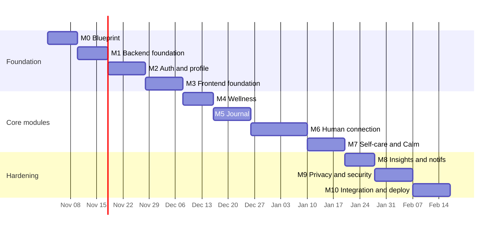

# HerSpace — Implementation Roadmap, Milestones and Testing Strategy

| Field | Value |
|---|---|
| Document ID | HS-PLAN-001 |
| Version | 1.0 |
| Date | 2026-10-31 |
| Traces to | `requirements.md` §4–§6, §10, all blueprint documents |
| Scope | Website v1 only. Android is explicitly out of scope (NG-04). |

---

## 1. How to use this plan

- Work is organised into **milestones (M0–M10)**. A milestone is complete only when its **exit criteria** and **test gate** pass.
- No milestone starts before its dependencies are green. Documentation is updated in the same PR as the behaviour change.
- Estimates assume **one experienced full-stack developer** working sequentially, with design/content review available. They are planning ranges, not commitments.
- Every milestone produces a runnable, demoable increment. No milestone leaves `main` broken.
- "Done" always includes: migrations, tests, authorization matrix entries, audit events, and updated docs.

**Phase mapping to the product brief**

| Brief phase | Milestone(s) |
|---|---|
| 1 Requirements and design | M0 |
| 2 Backend foundation | M1 |
| 3 Frontend foundation | M2, M3 |
| 4 Emotional wellness | M4 |
| 5 Private journal | M5 |
| 6 Human connection | M6 |
| 7 Self-care and Calm Space | M7 |
| 8 Insights and notifications | M8 |
| 9 Privacy and security | M9 |
| 10 Integration and testing | M10 |
| 11 Deployment | M10 |

---

## 2. Milestone summary

| ID | Milestone | Duration | Depends on | Exit criteria (summary) |
|---|---|---|---|---|
| M0 | Blueprint and design baseline | 1.5 wk | — | This document set reviewed and internally consistent; ERD, API, wireframes signed off |
| M1 | Backend foundation | 1.5 wk | M0 | Django + Postgres + Docker running; custom user; settings split; CI green |
| M2 | Authentication and profile | 2 wk | M1 | Register/verify/login/reset/change/logout-all working with tests; onboarding API |
| M3 | Frontend foundation and shell | 2 wk | M2 | Vite app, design tokens, routing, guards, session, auth pages, app shell |
| M4 | Emotional wellness | 1.5 wk | M3 | Check-in upsert, history, calendar, detail, mood summary; E2E J2 green |
| M5 | Private journal | 2 wk | M4 | CRUD + search + tags + prompts + gratitude; privacy tests green |
| M6 | Human connection | 3 wk | M5 | Contacts, invitations, support requests, public responses, shares, expiry |
| M7 | Self-care and Calm Space | 2 wk | M6 | Routines + completion + history; breathing/grounding/meditation/affirmations |
| M8 | Insights and notifications | 1.5 wk | M7 | Weekly/monthly/overview reports; notification feed + preferences + reminders |
| M9 | Privacy, export, deletion, hardening | 2 wk | M6 | Export, deletion grace + purge, consent centre, `security.md` §14 checklist pass |
| M10 | Integration, UAT, deployment | 2 wk | M9 | 12 E2E journeys green, responsive/a11y audit, production deploy + backup drill |

**Hard dependencies:** M9 requires M6 (not M7/M8); it is sequenced after M8 for a single developer but can move earlier if M7/M8 slip (R-04).

**Total:** ~21 working weeks of effort (5 effort-days per week) for one developer. Parallelising design/content work can compress M3–M8 by ~2 weeks, to ~19. The schedule is deliberately front-loaded on auth and authorization because every later module depends on them.



> Gantt bars use effort-days (5 per working week); calendar dates are indicative, not a commitment.

---

## 3. Milestone detail

### M0 — Blueprint and design baseline (1.5 weeks)

**Deliverables**
- `docs/requirements.md`, `user-stories.md`, `workflows.md`, `database-design.md`, `api-documentation.md`, `wireframes.md`, `frontend-architecture.md`, `backend-architecture.md`, `security.md`, `roadmap.md`.
- ERD rendered and reviewed against the 18 workflows.
- Design tokens implemented as a static HTML token sheet for contrast review.

**Exit criteria**
- Every FR group is traced to user stories and, where applicable, to workflows, entities, endpoints, and pages (traceability table in `requirements.md` §10).
- Every endpoint that reads or writes user data maps to an entity in `database-design.md`; computed endpoints are documented as such.
- Every page in `wireframes.md` §19 maps to a route in `frontend-architecture.md` §3.
- No open contradiction between documents (review checklist below).

**Consistency review checklist**
| Check | Evidence |
|---|---|
| Entity names identical across DB, API, workflows | `grep` cross-reference table |
| Enum values identical in `database-design.md` §1.2, API endpoint schemas, backend `TextChoices` | one shared list |
| Route paths identical in `wireframes.md` §19 and `frontend-architecture.md` §3.1 | table diff |
| Field names identical in API examples and DB columns | mapping table |
| Every workflow has failure branches | `workflows.md` §2–19 |
| Every destructive action has a confirmation + audit event | FR-SET-03, audit vocabulary |
| No AI/public/stranger behaviour anywhere | NG-01…NG-10 review |

**Test gate:** documentation lint (markdown links resolve, mermaid parses), plus a manual read-through by a second person.

---

### M1 — Backend foundation (1.5 weeks)

**Work items**
1. Repo skeleton (`backend/`, `frontend/`, `docs/`, `docker-compose.yml`, `.gitignore`, `.editorconfig`).
2. Django project with split settings (`base/dev/prod/test`), `django-environ`, `.env.example`.
3. PostgreSQL 16 in Docker with a healthcheck; `pg_trgm` extension (no `citext`; Django 5.2 removed `CITextField`).
4. Custom `accounts.User` + `UserManager`; `AUTH_USER_MODEL` set **before** the first migrate.
5. `common/`: `UUIDModel`, `TimeStampedModel`, pagination, domain exceptions, exception handler, crypto helpers, audit helper, logging redaction filter.
6. Apps scaffolded with empty `models.py`, `urls.py`, `apps.py`.
7. CI: ruff, black, pytest, `makemigrations --check`, coverage upload.
8. `seed_reference_data` command skeleton.

**Exit criteria**
- `docker compose up` + `manage.py migrate` succeeds on a clean machine.
- `GET /api/v1/health/` returns `200` with DB status.
- CI is green and blocks on lint/format/missing migrations.
- A deliberate cross-tenant leak in a scratch test fails the authorization test harness (harness proven to work).

**Test gate**
```bash
pytest --cov=apps --cov=common --cov-fail-under=60
ruff check . && black --check .
python manage.py makemigrations --check --dry-run
```

---

### M2 — Authentication and profile (2 weeks)

**Work items**
- `accounts`: user model, tokens (email verify, reset, email change), register/login/logout/logout-all/session/csrf, lockout, throttles, session-version middleware, audit events.
- `profiles`: profile + preferences models, get/patch endpoints, onboarding completion, closed dismissible-suggestion vocabulary.
- `privacy`: `ConsentRecord` plus the grant/revoke/supersede service (the audit and export jobs remain later milestones).
- `notifications`: `Notification` model and the fixed-copy `notify_security` producer; the feed and reminders remain in M8.
- Email templates (verification, reset, email change notice, security alert) with no user content.
- Frontend-independent API tests for every auth branch.

**Exit criteria**
- All FR-AUTH and FR-PROF requirements implemented.
- Lockout, token expiry, token reuse, and enumeration behaviours covered by tests.
- Consent records created transactionally with registration.
- Password change invalidates other sessions.

**Test gate**
```bash
pytest apps/accounts apps/profiles apps/privacy apps/notifications -q
pytest common/tests/test_authorization_harness.py -q   # authz matrix starts here
```

---

### M3 — Frontend foundation and app shell (2 weeks)

**Work items**
- Vite + React + Router + Query client; ESLint with `jsx-a11y`.
- `styles/tokens.css`, reset, global; self-hosted fonts; theme boot script; reduced motion.
- `ui/` primitives with jest-axe tests: Button, TextField, TextArea, Select, Toggle, ChipGroup, Card, StatusPill, EmptyState, Skeleton, InlineAlert, ConfirmDialog, Sheet, Tabs, Toast.
- `AppShell`, `SidebarNav`, `BottomNav`, `MoreSheet`, `TopBar`, skip link, route announcer.
- Session context, axios client with CSRF + error normalisation, route guards.
- Auth pages: Welcome, Register, Login, Forgot, Reset, Verify, VerificationGate.
- Onboarding 5 steps.
- Dashboard skeleton with placeholder cards (real data from M4+).

**Exit criteria**
- Register → verify → onboarding → dashboard works end to end against the real API.
- Keyboard-only pass on all auth screens; axe clean.
- Theme switch persists server-side and does not flash.
- Route guards handle anonymous, unverified, incomplete onboarding, deletion-pending.

**Test gate**
- Playwright: **J1** (register → verify → onboarding → dashboard).
- Component tests for every `ui/` primitive.
- Lighthouse on `/login` and `/app` skeleton: LCP ≤2.5 s, CLS ≤0.1.

---

### M4 — Emotional wellness (1.5 weeks)

**Work items**
- `wellness` models + constraints (`uniq_mood_user_date`, intensity check).
- Services: upsert check-in, update, delete (with share revocation hook), calendar, weekly summary.
- Endpoints `api-documentation.md` §6.1–6.12.
- Frontend: check-in page, emotion picker, intensity slider, trigger picker, history, calendar, detail, mood strip.
- Dashboard check-in card wired to real data.

**Exit criteria**
- One check-in per local date enforced by DB and API; second submit updates.
- Calendar includes all days of the month with neutral empty cells.
- Deleting a mood entry revokes any active share.
- No "missed day" language anywhere.

**Test gate**
- API: create/update/validation/foreign-trigger/timezone cases.
- E2E: **J2** (check in twice, edit, view calendar, open detail).
- Authorization matrix: moods + triggers.

---

### M5 — Private journal (2 weeks)

**Work items**
- `journal` models, trigram indexes, tag normalisation, word count.
- Search with escaped `ILIKE`, snippets, filters.
- Endpoints `api-documentation.md` §9.1–9.9.
- Frontend: list, editor (new/edit), detail, gratitude, prompts, tag input, delete confirmation by title.
- Sentinel logging test for journal content.

**Exit criteria**
- CRUD + search + tags + prompts complete.
- Non-owned IDs return `404` for GET/PATCH/DELETE.
- Deleting an entry revokes shares and purges snapshots.
- Search p95 ≤400 ms with 5,000 seeded entries.
- Journal content absent from list responses and logs.

**Test gate**
- API + service tests, authorization matrix.
- E2E: **J3** (write → search → edit → delete with a shared entry).
- Sentinel test green.

---

### M6 — Human connection (3 weeks)

The largest and riskiest milestone. Split into three sub-steps, each demoable.

**M6a — Contacts and invitations (1 wk)**
- Contact model + duplicate constraints; CRUD; invite via email/manual link/WhatsApp/SMS deep link; resend/revoke; invitation list.
- Public invitation GET/respond with token state machine, consent record, notification, audit.
- Frontend: People list, contact form, contact detail, invitations page, public invitation page.
- Tests: duplicate detection, throttles, token expiry/reuse, consent creation, public page field allowlist.

**M6b — Support requests (1.5 wk)**
- `SupportRequest` + `SupportRequestShare`; snapshot builders; consent in the same transaction; idempotency; pending limit; expiry job; cancel; revoke share.
- Public support GET/respond with `select_for_update`.
- Frontend: support type picker, share picker with per-item consent, send flow, history, detail with honest status, alternatives block, public response page.
- Tests: consent required, ownership of shared entries, double response, expiry race, "pending never accepted" component test.

**M6c — Hardening pass (0.5 wk)**
- Copy review against `wireframes.md` §17 and `security.md` §13.
- Email templates reviewed for content leakage.
- Authorization matrix for contacts, invitations, support requests, shares.

**Exit criteria**
- A full support request can be sent, responded to via link, and reflected truthfully.
- No path shares content without an explicit consent record.
- Deleting a contact preserves request history with a name snapshot.
- Expired/declined requests offer alternatives and support resources.
- Public pages expose only documented fields (snapshot-tested).

**Test gate**
- E2E: **J4** (add → invite → accept), **J5** (request with share → respond → badge), **J6** (expiry → alternatives).
- API: state machine tests for invitation and support request.
- Authorization matrix green for all connection resources.

---

### M7 — Self-care and Calm Space (2 weeks)

**Work items**
- `selfcare`: routines, items, day/item completions, today view, complete/undo, history; contiguous sort order; weekday array validation.
- `calm_space`: activities, affirmations, favourites, sessions; breathing/grounding/meditation content seeded.
- Frontend: routine dashboard, form with reorder (drag + keyboard), detail, history; calm hub, breathing pacer, grounding steps, meditation timer, affirmations.
- Reduced-motion variants for all animations.

**Exit criteria**
- No streak, penalty, or guilt language; missed days simply absent.
- Not-scheduled routines are labelled, not failed.
- Completion is idempotent per `(routine, local_date)` and undo works.
- Calm timers are timestamp-based and survive tab backgrounding.
- Session recording validates duration and does not touch mood entries.

**Test gate**
- E2E: **J7** (routine create → complete → undo → history), **J8** (breathing with reduced motion).
- Component tests for `BreathePacer` (static + animated) and reorder keyboard support.

---

### M8 — Insights and notifications (1.5 weeks)

**Work items**
- `insights` services: weekly, monthly, overview; template copy with evidence; insufficient-data guard; banned-phrase test.
- `notifications`: model, producers, feed, unread count, read/read-all; preferences respected; reminder command with quiet hours.
- Frontend: insights hub, weekly, monthly, chart + table fallback, notification page, badge polling, settings notifications.
- Export-ready notification stub (real export in M9).

**Exit criteria**
- Every statement carries evidence and passes the banned-phrase lint.
- `<3` check-ins → insufficient-data state, no trend line.
- Notification bodies contain no private content (sentinel test).
- Quiet hours suppress non-security notifications.
- Unread badge polls without breaking reduced-motion or a11y.

**Test gate**
- E2E: **J9** (insufficient data → enough data), **J10** (notification → target page).
- Unit: all insight templates rendered and scanned.

---

### M9 — Privacy, export, deletion, hardening (2 weeks)

**Work items**
- Consent centre (list/current/history, revoke rules).
- Export: request, build job (ZIP contents per `security.md` §10.4), one-time download token, expiry/purge.
- Deletion: schedule with password + phrase, deactivate, cancellation email, cancel endpoints, purge job, audit anonymisation.
- Privacy page, terms page, support resources page and reference data.
- Security hardening: headers/CSP, logging filter verification, rate limits, admin restrictions, dependency audit.
- Full `security.md` §14 checklist run.

**Exit criteria**
- Export archive verified against the contents list; excluded fields proven absent.
- Deletion purge leaves no owned rows, deletes export files, anonymises audit events.
- Cancellation via emailed token restores access.
- Security checklist: every item Pass with evidence attached to the release PR.
- Banned-phrase lint and sentinel tests green.

**Test gate**
- E2E: **J11** (export → download once → blocked), **J12** (delete → cancel → delete → purge).
- Restore drill from a backup into a scratch DB.
- `pip-audit` and `npm audit` clean of high/critical.

---

### M10 — Integration, UAT, deployment (2 weeks)

**Work items**
- Full regression of the 12 journeys in a production-like environment.
- Responsive pass at 320/375/768/1024/1280/1440.
- Accessibility audit: axe on every route + manual keyboard + screen-reader spot check (NVDA or VoiceOver).
- Performance: Lighthouse budgets, API p95 measurements, 5,000-entry search benchmark.
- Production: nginx TLS, gunicorn, env vars, private storage permissions, cron timers, backups, monitoring, `security.txt`.
- UAT with the intended user; fix blockers; freeze content.
- Runbook: deploy, rollback, restore, rotate secrets, handle a support-resource correction.

**Exit criteria**
- All 12 E2E journeys pass on the deployed environment.
- No open S1/S2 issues; S3 issues triaged with dates.
- Backup restore verified within RTO; monitoring alerts fire on a simulated 5xx spike.
- UAT sign-off.
- Rollback rehearsed (previous release restored in <15 minutes).

**Test gate:** the release checklist in `security.md` §14 plus `roadmap.md` §4.4.

---

## 4. Testing strategy

### 4.1 Levels

| Level | Scope | Tooling | Gate |
|---|---|---|---|
| Unit | Services, validators, token logic, insight copy, calendar filling | pytest / Vitest | ≥90% on services and hooks |
| API integration | Endpoints, validation, status codes, transactions | DRF `APIClient` + pytest | every endpoint has happy + error + authz tests |
| Authorization matrix | Cross-user access for every resource | pytest parametrised | 100% of resources, 0 failures |
| Component | UI primitives and domain components | Testing Library + jest-axe | every `ui/` component |
| E2E | 12 critical journeys | Playwright | all green before release |
| Responsive | 320/768/1280 screenshots | Playwright | no overflow, no clipped actions |
| Accessibility | axe + keyboard + SR spot check | axe-core, manual | zero serious/critical |
| Performance | API p95, Lighthouse, search benchmark | k6/locust (light), Lighthouse CI | NFR-PERF targets |
| Security | Checklist + sentinel + dependency audit | manual + scripts | `security.md` §14 |
| Recovery | Backup restore, rollback | manual drill | RTO/RPO met |

### 4.2 Test data rules

- Factories generate realistic but synthetic data; **never** use real personal content in fixtures.
- Every suite creates its own users (`owner`, `other_user`, `staff_user`) to make cross-tenant tests explicit.
- Time-dependent tests use `freezegun`; no `sleep()` in tests.
- Email is captured with `django.core.mail.outbox`; no real SMTP in CI.
- Private storage is a `tmp_path` fixture; tests assert files are deleted after purge.

### 4.3 Environments

| Environment | Purpose | Data |
|---|---|---|
| Local | Development | Seeded synthetic |
| CI | Automated gates | Ephemeral Postgres service container |
| Staging | UAT, E2E, restore drills | Synthetic, production-like volume |
| Production | Real use | Real |

Staging mirrors production settings except `DEBUG=False` and real email (a sink mailbox).

### 4.4 Release gate (all must pass)

1. `pytest` with coverage thresholds; authorization matrix 100%.
2. `ruff`, `black --check`, ESLint, Prettier.
3. `makemigrations --check`, `spectacular --validate` (no schema drift).
4. `npm run build` under bundle budget; no source maps served.
5. 12 E2E journeys green on staging.
6. axe: zero serious/critical; manual keyboard pass on all routes.
7. `security.md` §14 checklist complete with evidence.
8. Backup restore drill completed this quarter.
9. Rollback rehearsed.
10. Docs updated (`CHANGELOG.md`, `docs/decisions.md` if a decision changed).

---

## 5. The 12 critical end-to-end journeys

These are the only E2E tests that must exist before launch. Each is written as a Playwright spec with a real browser against staging.

| # | Journey | Steps | Pass criteria |
|---|---|---|---|
| J1 | First run | Register → verify email (token from sink mailbox) → onboarding (5 steps) → dashboard | Lands on `/app`, greeting shows display name, no console errors, `onboarding_completed_at` set |
| J2 | Check in twice | Open check-in → select 3 emotions, intensity 6, note → save → reopen → change intensity to 7 → save → calendar → detail | One entry for today, intensity 7, no duplicate, calendar cell reflects it |
| J3 | Journal lifecycle | Create entry with 2 tags → search by a word → edit title → share in a support request → delete entry | Search finds it, edit persists, share shows the withdrawal notice, entry gone |
| J4 | Invitation | Add contact → invite by email → open public link in a clean context → accept | Contact becomes `active`, owner gets notification, public page never shows owner email |
| J5 | Support request | Create request with mood share → open response link → accept with note | Owner sees `accepted`, note, "via link" badge; share snapshot visible |
| J6 | Expiry honesty | Create request with a frozen clock, advance 73 h, run expiry job | Status `expired`, notification exists, alternatives + resources block shown |
| J7 | Routine day | Create routine with 3 items → complete 2 → undo 1 → open history | Progress 1/3, history shows the day, no streak text |
| J8 | Calm with reduced motion | Enable reduced motion → start box breathing → pause → end | Static pacer, session saved with duration, no animation classes |
| J9 | Insights threshold | Fresh account with 2 check-ins → weekly report → add a third → reload | First shows "Not enough data yet" and no chart line; second shows statements with counts |
| J10 | Notification | Trigger a contact acceptance → open notifications → click item | Badge decrements, item marked read, navigates to the contact |
| J11 | Export | Request export → wait for ready → `POST …/download/` → `GET …?token=` → retry the same GET URL | ZIP contains `manifest.json` and `journal.json`; retried GET returns `409 token_used` |
| J12 | Deletion | Request deletion → open cancel link from email → log in → request deletion again → run purge | Cancel restores login; after purge, login fails and owned rows are gone |

**Test hygiene:** each journey uses a unique email (`e2e+<uuid>@example.test`), cleans up via the deletion purge job in teardown, and asserts at least one `aria-live` announcement for async status.

---

## 6. Definition of Done (per ticket)

A ticket is done only when:

1. Behaviour matches the FR/BR it implements; no undocumented behaviour shipped.
2. Server-side validation exists for every new input; DB constraints where applicable.
3. Ownership checks and an authorization-matrix entry exist for every new resource.
4. Audit events are written for security-relevant actions (per `database-design.md` §11.5).
5. No private content in logs, notifications, emails, or errors (sentinel test extended if needed).
6. Tests: unit + API + (component or E2E) for the changed path.
7. Accessibility: keyboard operable, labelled, focus visible, axe clean.
8. Responsive at 320 px and 1280 px.
9. Copy reviewed against `wireframes.md` §17 and the banned-phrase list.
10. Docs updated: API doc if endpoints/fields changed, DB doc if schema changed, changelog entry.
11. Migrations are reversible or have a documented forward-only justification.
12. PR reviewed by someone other than the author (or a self-review checklist if solo, recorded in the PR).

---

## 7. Risk register

| ID | Risk | Likelihood | Impact | Mitigation | Trigger to act |
|---|---|---|---|---|---|
| R-01 | Authorization bug leaks private data | Medium | Critical | Queryset scoping, matrix tests, 404 policy, review checklist | Any matrix failure blocks release |
| R-02 | Support-request consent logic ships incorrectly | Medium | High | Single service function, transaction tests, explicit API contract | Any share without a consent record |
| R-03 | Scope creep toward AI/chat/social | Medium | High | NG-01…NG-10 enforced in review; no messaging schema migrated | Any feature request outside `requirements.md` §1.2 |
| R-04 | Solo-developer schedule slip | High | Medium | Milestones are independently demoable; M7/M8 can slip without blocking MVP (M9 depends on M6, not M7) | Two consecutive milestones >25% over |
| R-05 | Email deliverability (invitations, resets) | Medium | High | SPF/DKIM/DMARC, sink-mailbox tests, in-app fallbacks (copy link) | Bounce rate >2% |
| R-06 | Accessibility regressions | Medium | Medium | axe in CI, keyboard journeys, review checklist | Any serious/critical axe finding |
| R-07 | Performance of journal search / insights | Low | Medium | Trigram indexes, benchmarks, aggregation limits, cache path documented | p95 >400 ms |
| R-08 | Deletion leaves residual data | Low | Critical | Purge job tests, cascade review, backup policy documented | Any orphan row after purge test |
| R-09 | Token leakage via logs/referrers | Low | High | Redaction filter, `no-referrer`, path redaction, sentinel tests | Any token pattern in logs |
| R-10 | Content harm (bad advice, unsafe resources) | Low | High | Banned phrases, human-reviewed resources, disclaimers | Any user report |
| R-11 | Backup unusable when needed | Low | Critical | Monthly restore drill | Drill failure |
| R-12 | Dependency vulnerability | Medium | Medium | Monthly audit, lockfiles, no CDN | High/critical advisory |

---

## 8. Sequencing rules (what must not be parallelised)

1. **Custom user model before first migrate** (M1). Changing it later is painful.
2. **Authorization matrix before any module's UI** (M2 onward). Retrofitting it is how leaks happen.
3. **Consent service before support requests** (M6b). The share flow must call one function.
4. **Audit helper before auth** (M1/M2). Security events cannot be backfilled.
5. **Logging redaction before journal** (M5). One leaked log line is unrecoverable.
6. **Export/deletion before launch** (M9). They are MVP requirements, not nice-to-haves.
7. **Security checklist before deployment** (M10). Deployment is not the place to discover CSRF gaps.
8. **Android after stability** (post-v1). No shared-code extraction before the web API is frozen.

---

## 9. Post-launch (first 90 days)

| Week | Focus |
|---|---|
| 1–2 | Monitor 5xx/429/423 rates, job failures, email bounces; fix S3 issues |
| 3–4 | UAT feedback round: copy, empty states, mobile ergonomics |
| 5–8 | Performance tuning (insight caching if needed), search quality |
| 9–12 | Decide OD-01…OD-06 (multiple check-ins, soft delete, encryption, push, i18n); write ADRs before implementing |
| Ongoing | Monthly dependency audit, quarterly restore drill, 12-month support-resource review |

**v2 candidate backlog (not started):** multiple check-ins per day, journal trash, web push, in-app messaging between linked accounts, application-level encryption, localisation, Android client.

---

## 10. Phase → requirement coverage

| Milestone | Requirements closed |
|---|---|
| M1 | NFR-MAINT-01…05 (foundation), NFR-SEC-07 |
| M2 | FR-AUTH-01…13, FR-PROF-01…05, NFR-SEC-02, NFR-SEC-03, NFR-SEC-06 |
| M3 | NFR-A11Y-01…06 (baseline), NFR-COMP-01…04, NFR-PERF-02 |
| M4 | FR-WELL-01…07, BR-01, BR-14 |
| M5 | FR-JRNL-01…09, BR-10 |
| M6 | FR-CONN-01…18, FR-WELL-09, BR-04…BR-09, BR-15, BR-19 |
| M7 | FR-SELF-01…08, FR-CALM-01…07, BR-11, BR-13 |
| M8 | FR-INSN-01…05, FR-NOTF-01…05, BR-12 |
| M9 | FR-PRIV-01…09, FR-SET-01…03, NFR-PRIV-01…06, NFR-SEC-01…10 |
| M10 | NFR-PERF-01…05, NFR-REL-01…05, SC-01…06 |

---

## 11. What "launch" does not include

To prevent scope confusion at the finish line, launch explicitly excludes:

- Android app, PWA install prompts, offline mode.
- Real-time chat, voice/video, group support.
- AI features of any kind.
- Public profiles, sharing outside the one-recipient support flow.
- Payments, subscriptions, ads.
- Multi-language UI.
- Third-party analytics or crash reporting with payloads.
- Staff access to user content.

These are not "unfinished" — they are out of scope by design (`requirements.md` §1.3).
