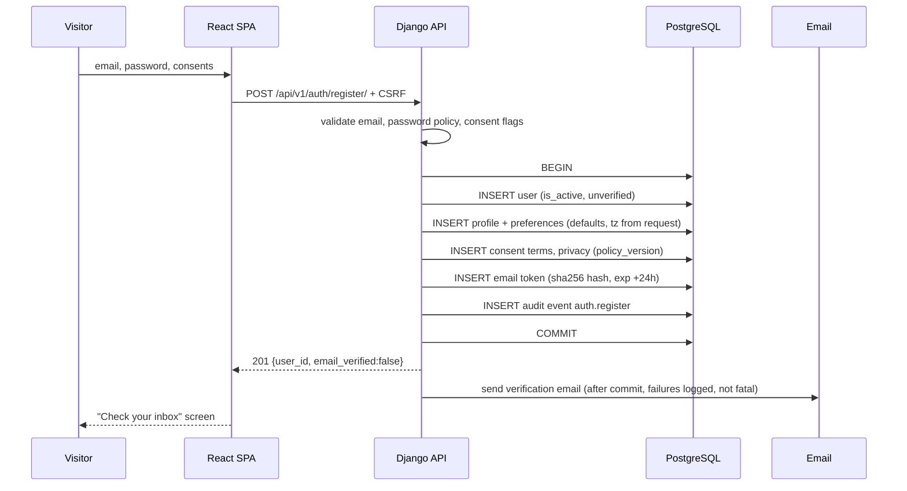
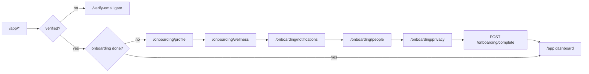
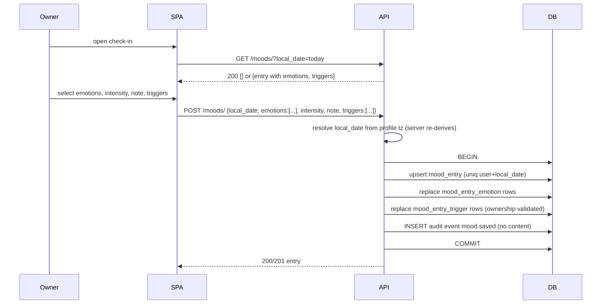
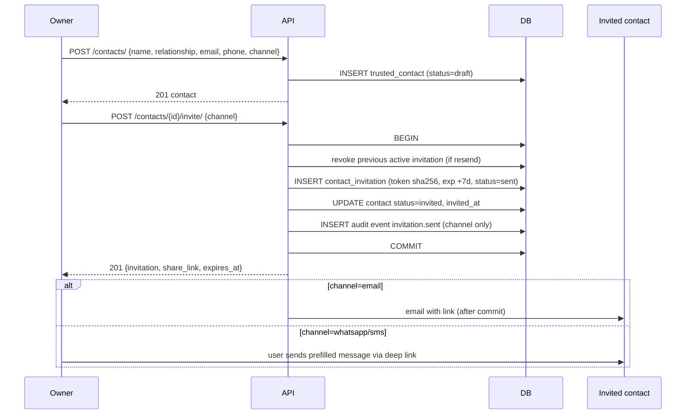
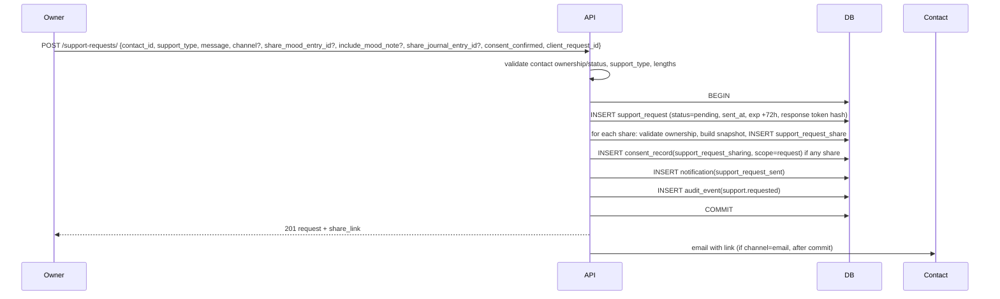
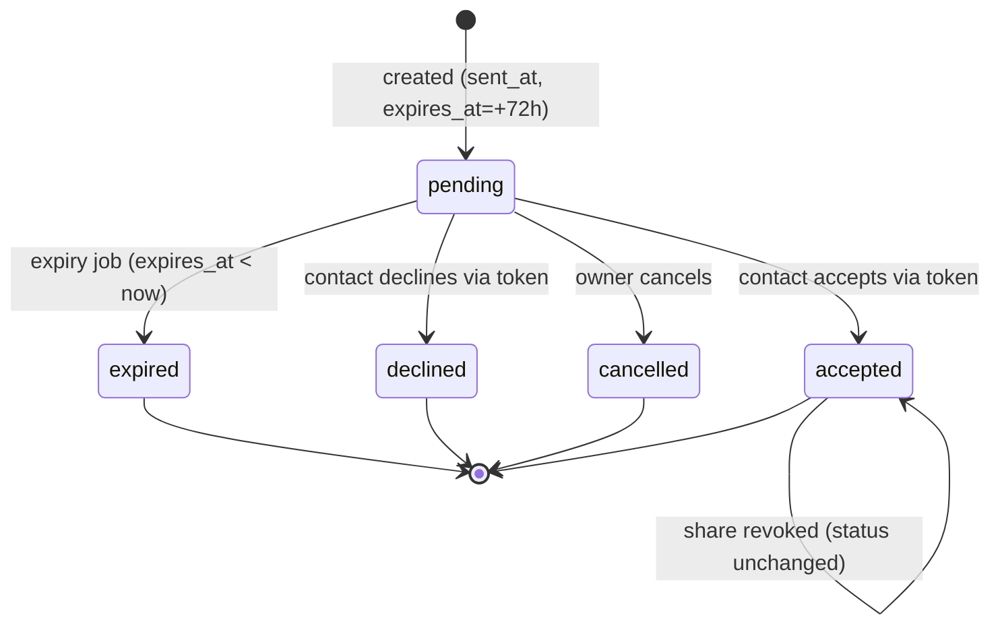
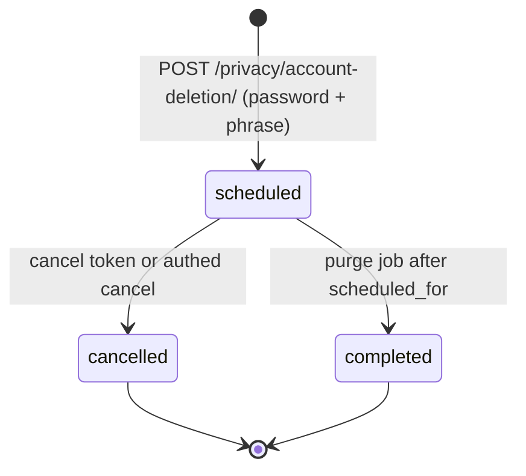

# HerSpace — User Workflows and State Machines

| Field | Value |
|---|---|
| Document ID | HS-WF-001 |
| Version | 1.0 |
| Date | 2026-10-31 |
| Traces to | `requirements.md` §4, `user-stories.md` |
| Purpose | Bind every meaningful user journey to concrete entities, endpoints, transactions, and failure paths |

Each workflow lists: trigger, actors, preconditions, numbered steps (UI → API → data), invariants, and failure branches. Entity names match `database-design.md`; endpoint paths match `api-documentation.md`.

---

## 1. Workflow index

| ID | Workflow | Actors | Primary endpoints | Entities |
|---|---|---|---|---|
| WF-01 | Registration and email verification | Visitor | `POST /auth/register/`, `POST /auth/verify-email/` | `User`, `ConsentRecord`, `EmailVerificationToken`, `UserProfile`, `UserPreferences` |
| WF-02 | Login, lockout, session | Owner | `POST /auth/login/`, `GET /auth/session/`, `POST /auth/logout/` | `User`, `AuditEvent` |
| WF-03 | Password reset and change | Owner | `POST /auth/password-reset/`, `POST /auth/password-reset/confirm/`, `POST /auth/password-change/` | `PasswordResetToken`, `AuditEvent`, `Notification` |
| WF-04 | Onboarding | Owner | `PATCH /profile/`, `PATCH /preferences/`, `POST /onboarding/complete/` | `UserProfile`, `UserPreferences`, `TrustedContact` |
| WF-05 | Daily mood check-in (create or edit) | Owner | `POST /moods/`, `PATCH /moods/{id}/` | `MoodEntry`, `MoodEntryEmotion`, `MoodEntryTrigger` |
| WF-06 | Mood review (history, calendar, summary) | Owner | `GET /moods/`, `GET /moods/calendar/`, `GET /moods/insights/` | `MoodEntry` (read) |
| WF-07 | Add contact and send invitation | Owner | `POST /contacts/`, `POST /contacts/{id}/invite/` | `TrustedContact`, `ContactInvitation`, `ConsentRecord` |
| WF-08 | Invitation response (public) | Invited contact | `GET/POST /public/invitations/{token}/` | `ContactInvitation`, `TrustedContact`, `ConsentRecord`, `Notification` |
| WF-09 | Create support request with optional shares | Owner | `POST /support-requests/` | `SupportRequest`, `SupportRequestShare`, `ConsentRecord`, `Notification`, `AuditEvent` |
| WF-10 | Support request response (public) | Invited contact | `GET/POST /public/support-requests/{token}/` | `SupportRequest`, `Notification`, `AuditEvent` |
| WF-11 | Expiry, cancel, decline, share revocation | Owner / System | `POST /support-requests/{id}/cancel/`, `DELETE /support-requests/{id}/shares/{shareId}/`, expiry job | `SupportRequest`, `SupportRequestShare`, `ConsentRecord`, `Notification` |
| WF-12 | Journal create, search, edit, delete | Owner | `/journal/` CRUD | `JournalEntry`, `JournalTag`, `JournalEntryTag` |
| WF-13 | Routine creation and daily completion | Owner | `/routines/`, `POST /routines/{id}/complete/` | `Routine`, `RoutineItem`, `RoutineDayCompletion`, `RoutineItemCompletion` |
| WF-14 | Calm Space session | Owner | `POST /calm/sessions/` | `CalmSession`, `CalmActivity` |
| WF-15 | Insight generation | Owner | `GET /insights/weekly/`, `GET /insights/monthly/` | read-only aggregation |
| WF-16 | Notification lifecycle | System / Owner | `GET /notifications/`, `PATCH /notifications/{id}/` | `Notification` |
| WF-17 | Data export | Owner / System | `POST /privacy/export/`, `POST /privacy/export/{id}/download/`, `GET /privacy/export/{id}/download/?token=` | `DataExportRequest`, `Notification` |
| WF-18 | Account deletion with grace period | Owner / System | `POST /privacy/account-deletion/`, public cancel | `AccountDeletionRequest`, `AuditEvent` |

---

## 2. WF-01 — Registration and email verification

**Trigger:** visitor submits the registration form.
**Preconditions:** no active session; Terms and Privacy versions known.



**Steps**
1. SPA validates shape locally (email, 12+ chars, consents) but the server is authoritative.
2. API normalises email to lowercase, checks the `UPPER(email)` unique index → `409 email_in_use`.
3. API checks password against Django validators + common-password list.
4. Single transaction: `User` → `UserProfile` → `UserPreferences` → 2 × `ConsentRecord` → `EmailVerificationToken` → `AuditEvent`.
5. Response `201` contains `id`, `email`, `email_verified: false`, `onboarding_required: true`. No token, no hash.
6. After commit, `transaction.on_commit` dispatches the verification email with a 24-hour link.
7. User clicks `/verify-email/:token` → `POST /auth/verify-email/` with the raw token.
8. API hashes and looks up; on match and not expired and not used → set `email_verified_at`, `used_at`, audit `auth.email_verified`, response `200`.

**Invariants**
- A user never exists without profile, preferences, and the two required consent records.
- Raw tokens exist only in the email and in memory; the database stores SHA-256 only.
- Duplicate registration does not reveal whether the email exists beyond the `409` on an authenticated-shape form (accepted trade-off, documented in `security.md` §6.3).

**Failure branches**
| Condition | Result |
|---|---|
| Consent missing | `400 fields.consents`, nothing written |
| Weak password | `400 fields.password` |
| Email exists | `409 email_in_use` |
| Email dispatch fails | Registration still succeeds; user can resend (FR-AUTH-05); error logged without PII |
| Token expired | `410 token_expired`, recovery screen |
| Token reused | `409 token_used`, no state change |

---

## 3. WF-02 — Login, lockout, session

**Trigger:** user submits credentials.
**Preconditions:** account exists and is not scheduled for deletion.

**Steps**
1. `POST /auth/login/` with email + password, CSRF header present.
2. API checks `AccountDeletionRequest(status='scheduled')` → `403 deletion_pending` with `scheduled_for` (no session).
3. API checks `locked_until > now` → `423 account_locked` with `retry_after_seconds`.
4. Authenticate: on failure increment `failed_login_count`; at 10 set `locked_until = now + 15 min`, audit `auth.lockout`.
5. On success: reset counter, `last_login`, rotate session id, audit `auth.login`.
6. Response `200`: `{user:{id,email,display_name,email_verified}, onboarding_required, deletion_scheduled:false}`.
7. SPA calls `GET /auth/session/` on boot to rehydrate; `401` means anonymous.
8. Logout destroys the session and clears cookies; "log out everywhere" bumps a per-user session version so all other sessions fail.

**Invariants**
- The failure response body and status are identical for unknown email and wrong password.
- No private content in `AuditEvent.metadata` (only `email_domain_hash` optional, never the address).
- Session cookie is `HttpOnly`; CSRF cookie is readable by JS by design.

---

## 4. WF-03 — Password reset and change

**Reset steps**
1. `POST /auth/password-reset/` with email → always `202` with neutral copy.
2. If the account exists and is active: create `PasswordResetToken` (hash, 60 min), invalidate prior unused tokens, send email after commit, audit `auth.password_reset_requested`.
3. User opens `/reset-password/:token`; SPA posts `{token, new_password}` to `/auth/password-reset/confirm/`.
4. API validates token (hash match, unused, unexpired, `created_at > user.password_changed_at`), sets password, `password_changed_at = now`, marks token used, deletes other unused reset tokens, bumps session version (all sessions end), creates `security_alert` notification, audit `auth.password_reset_completed`.

**Change steps (authenticated)**
1. `POST /auth/password-change/` with `current_password`, `new_password`.
2. Verify current password; validate new; reject if unchanged.
3. Same post-conditions as reset, except the current session is preserved and re-issued.

**Invariants**
- Reset response time and body do not vary with account existence.
- Tokens are invalidated by any password change.

---

## 5. WF-04 — Onboarding

**Trigger:** verified user with `onboarding_completed_at IS NULL` opens `/app/*`.



**Steps**
1. Router guard reads `session.onboarding_required` from `GET /auth/session/`.
2. Step 1: display name (prefilled), timezone (detected, user-confirmable), optional pronouns/bio → `PATCH /profile/`.
3. Step 2: wellness preferences — week start, check-in reminder opt-in, calm defaults → `PATCH /preferences/`.
4. Step 3: notification preferences — in-app/email toggles, quiet hours → `PATCH /preferences/`.
5. Step 4 (skippable): add a contact as `draft`, no invitation sent from onboarding.
6. Step 5: privacy and consent explanation; requires an explicit acknowledgement checkbox → `POST /onboarding/complete/` writes `onboarding_completed_at` and `ConsentRecord(wellness_disclaimer)` in one transaction.
7. Redirect to `/app`.

**Invariants**
- Progress is derived from stored data, never from client-only state.
- Skipping steps 1–4 is allowed; step 5 acknowledgement is mandatory.
- No invitation email is sent during onboarding.

---

## 6. WF-05 — Daily mood check-in (create or edit)

**Trigger:** user taps "How are you feeling today?".
**Preconditions:** verified, onboarding complete.



**Steps**
1. SPA loads today's entry via list filter `local_date=today` (server computes "today" from profile timezone; client passes its own date only as a hint).
2. Server derives `local_date` from `UserProfile.timezone` at write time and snapshots `timezone` on the row.
3. `POST /moods/` is an **upsert** keyed by `(user, local_date)`: `201` when created, `200` when updated. Response includes `created` boolean.
4. Emotion IDs must be active reference rows; at least 1, at most 12.
5. Trigger IDs must belong to the caller; unknown/foreign IDs → `400 fields.triggers` (no existence leak).
6. Note is trimmed; empty string stored as `NULL`.
7. `AuditEvent` records `mood.saved` with `{local_date, emotion_count}` only.

**Invariants**
- BR-01 enforced by DB unique constraint, not by a read-then-write check.
- No mood content in audit metadata or logs.
- Editing today's entry never changes `local_date`.

**Failure branches**
| Condition | Result |
|---|---|
| 0 emotions | `400 fields.emotions` |
| intensity ∉ 1..10 | `400 fields.intensity` |
| note > 2000 chars | `400 fields.note` |
| foreign trigger id | `400 fields.triggers` |
| `local_date` in the future (beyond today in user tz) | `400 fields.local_date` (backfill allowed, future not) |

---

## 7. WF-06 — Mood review

**Steps**
1. History: `GET /moods/?from=&to=&emotion=&min_intensity=&max_intensity=&page=` — ordered by `local_date DESC`.
2. Calendar: `GET /moods/calendar/?year=2026&month=10` returns `{days:[{date, intensity, emotions:[key], entry_id|null}], summary:{count, average_intensity}}`. Days without entries are absent from `days` (the SPA renders neutral cells).
3. Detail: `GET /moods/{id}/` returns the entry plus linked emotions/triggers and a `shared_in_requests` count (no recipient identities beyond what the user created).
4. Weekly/monthly: `GET /moods/insights/?period=week&anchor=2026-10-26` — aggregation described in WF-15.
5. All read paths filter `user=request.user` in the queryset.

**Invariants**
- No "missed day" concept exists in the API; the API never returns a day as failed.
- Timezone changes do not rewrite `local_date` (BR-14, AS-06).

---

## 8. WF-07 — Add contact and send invitation

**Trigger:** user adds someone to My People and chooses to invite.



**Steps**
1. `POST /contacts/` validates name (1–120), relationship (≤60, free text), email format, phone E.164-ish, and that at least one channel exists when `preferred_channel != none`.
2. Duplicate detection: partial unique on `(owner, lower(email))` and `(owner, normalized_phone)` for non-revoked contacts → `409 duplicate_contact` with `existing_id`.
3. Invite requires a deliverable channel. For `email`, the server sends. For `whatsapp`/`sms`, the server returns a prefilled deep link and a copyable message; the contact is set to `invited` only after the SPA confirms the user sent it (`POST /contacts/{id}/invite/` with `channel=whatsapp|sms` and `user_confirmed_send=true`). For `manual_link`, a 7-day link is returned.
4. The invitation email contains: owner display name, relationship label, what a trusted contact is, the accept/decline link, expiry, and a "you can ignore this" line. It contains **no** mood or journal content.
5. Response includes `share_link` (raw token URL) exactly once; it is not retrievable later (only resend generates a new one).

**Invariants**
- At most one non-terminal invitation per contact (partial unique index).
- Token is single-use, hashed at rest, expires in 7 days.
- Sending an invitation never creates a support request and never shares content.
- Rate limit: 1 invite per contact per 60 minutes; 20 invites per user per day.

**Failure branches**
| Condition | Result |
|---|---|
| No channel for invite | `400 fields.channel` + UI disables action |
| Contact `declined`/`revoked` | Allowed to re-invite; status returns to `invited` |
| Throttled | `429 invite_throttled` with `retry_after_seconds` |
| Email bounce (async) | Invitation stays `sent`; owner sees "delivery may have failed" after 24 h without `opened_at` |

---

## 9. WF-08 — Invitation response (public, unauthenticated)

**Trigger:** invited person opens `/invitation/:token`.

```mermaid
flowchart TD
    A[GET /public/invitations/:token/] --> B{token valid?}
    B -- expired/used/revoked --> C[410 / 409 state screen]
    B -- valid --> D[Show owner display name, relationship, what this means]
    D --> E{Accept or Decline}
    E -- Accept --> F[POST respond {action:accept}<br/>BEGIN: invitation.accepted, contact.active,<br/>consent contact_invitation, notification, audit COMMIT]
    E -- Decline --> G[POST respond {action:decline, note?}<br/>invitation.declined, contact.declined, notification, audit]
    F --> H[Confirmation: "You can now be asked for support.<br/>You can withdraw by telling them."]
    G --> I[Confirmation: "No further contact will be made."]
```

**Steps**
1. `GET /public/invitations/{token}/` — rate limited 30/hour/IP, returns only: owner display name, relationship, invitation created/expiry, status, and a `can_respond` boolean. No contact email/phone, no other contacts, no content.
2. `POST /public/invitations/{token}/respond/` body `{action: "accept"|"decline", note?: string}`.
3. Server transaction: lock invitation row (`SELECT … FOR UPDATE`), verify `status='sent'` and not expired, update invitation + contact, insert `ConsentRecord(user=contact.owner, consent_type='contact_invitation', scope_type='contact_invitation', scope_id=contact.id, granted=action=='accept', revoked_at=now() if declining)`, insert `Notification(category='invitation_accepted'|'invitation_declined')` for owner, insert `AuditEvent`.
4. On accept, `contact.status='active'`, `responded_at=now`; on decline, `contact.status='declined'`.
5. Owner notification copy is neutral: "Alex responded to your invitation." / "Alex declined your invitation. That's okay — you can add someone else whenever you want."

**Invariants**
- The public page never exposes the owner's email, mood, journal, or other contacts.
- Double response → `409 already_responded`.
- Expired token → `410 token_expired`; the owner sees `expired` after the expiry job runs.
- The response is unverified by design (anyone with the link can act); this is stated in `security.md` §7.3 and reflected in the UI.

---

## 10. WF-09 — Create support request with optional shares

**Trigger:** user taps "I Need Someone" and sends a request.
**Preconditions:** at least one contact exists; target contact is not `declined`/`revoked`.



**Steps**
1. Validate `contact_id` belongs to caller and status ∈ {`active`, `invited`, `unavailable`} (warn on `invited`).
2. Validate `support_type` ∈ `talk|advice|lonely|company|difficult_day|listen`.
3. Validate `message` ≤1000 chars; optional.
4. Shares: `share_mood_entry_id` must be caller's; `share_journal_entry_id` must be caller's. If either present, `consent_confirmed` must be `true` → else `400 consent_required`.
5. Transaction:
   - `SupportRequest` created with `status='pending'`, `sent_at`, `expires_at = now + 72h`, `response_token_hash`, `contact_name` snapshot.
   - For each share: `SupportRequestShare` with `resource_type` (`mood`|`journal`), `resource_id`, `snapshot` JSON (rendered copy), `granted_at`.
   - One request-scoped `ConsentRecord(consent_type='support_request_sharing', scope_type='support_request', scope_id=request.id, granted=true, metadata={"share_types":[…],"share_ids":[…]})` when at least one share is present; none when there are no shares. Each share remains individually revocable; the request-level consent is revoked only when the last active share is withdrawn or its source is deleted.
   - `Notification(category='support_request_sent')` — body has contact name and type only.
   - `AuditEvent('support.requested', target=request.id, metadata={support_type, share_count, channel})`.
6. After commit: dispatch email (if channel=email) with the response link.
7. Response `201` includes `share_link` once, `expires_at`, and `status='pending'`.

**Snapshot rules**
- Mood snapshot: `{local_date, intensity, emotions:[{key,label}], note}` — note included only if the user ticked "include my note".
- Journal snapshot: `{title, entry_date, category, content}`.
- Snapshots are immutable copies; later edits to the source do not change them (FR-JRNL-09).
- Deleting the source entry revokes the share and deletes the snapshot (US-W4, US-J4).
- Revoking a share nulls the snapshot and sets `revoked_at`.

**Invariants**
- BR-04: exactly one recipient, owned by the requester.
- BR-06: at most one mood + one journal share per request (unique `(request, resource_type)`).
- BR-07: response is `pending`; UI must not imply acceptance.
- `client_request_id` (uuid, optional) makes retries idempotent: duplicate → `200` with the existing request, no second email.

**Failure branches**
| Condition | Result |
|---|---|
| Contact not owned | `404` |
| Contact `declined`/`revoked` | `409 contact_unavailable` |
| Share without consent | `400 consent_required` |
| Foreign entry id | `400 fields.share_*` (no existence leak) |
| Duplicate `client_request_id` | `200` existing request, no re-send |
| 5 pending requests already | `429 too_many_pending` (prevents spam) |

---

## 11. WF-10 — Support request response (public, unauthenticated)

**Trigger:** contact opens `/support-response/:token`.

**Steps**
1. `GET /public/support-requests/{token}/` - rate limited 60/hour/IP. Returns: owner display name, support type label, message, active share snapshots, revoked shares as `{resource_type, withdrawn:true}` with no content, sent time, expiry, `can_respond`, `status`.
2. If `status='expired'` or `expires_at < now` → the API returns `410 token_expired` and a read-only explanation. The expiry job flips status; the read path also treats past-expiry pending requests as expired (defensive).
3. `POST /public/support-requests/{token}/respond/` body `{action:"accept"|"decline", note?}`.
4. Transaction with `SELECT … FOR UPDATE` on the request: verify `pending` and not expired; set `status`, `responded_at`, `response_note`, `response_verified=false`; insert `Notification` for owner (category `support_request_response`); insert `AuditEvent('support.responded')`.
5. `201` response includes only the acknowledgement, not the owner's data.

**Invariants**
- Accepted ≠ guaranteed availability; the confirmation copy says "Thanks for letting them know."
- The response token stops working after a response (`409 already_responded`).
- Response notes are visible to the owner but never logged.
- Only the explicitly shared snapshot is visible; no live data access.

---

## 12. WF-11 — Expiry, cancel, decline, share revocation

**State machine**



**Rules**
- Only `pending → cancelled` is owner-mutable. Accept/decline happen only via token (or future linked-account endpoint).
- Expiry job runs every 15 minutes: `UPDATE support_requests SET status='expired' WHERE status='pending' AND expires_at < now()`; for each, insert `Notification(category='support_request_expired')` and audit. No content in the notification.
- Cancel: allowed only while `pending`; sets `cancelled`, `responded_at=NULL`, invalidates response token, audits.
- Share revocation: `DELETE /support-requests/{id}/shares/{shareId}/` → sets `revoked_at`, nulls `snapshot`, audits; if no non-revoked shares remain, also inserts `ConsentRecord(granted=false, revoked_at=now(), scope=request)`. Status is unchanged; the recipient page shows a withdrawal notice for that share.
- Consent-centre revocation: `POST /privacy/consents/` with `consent_type='support_request_sharing'`, `granted=false`, and the request scope → revokes **every active share** under that request (same nulling/audit path) and writes the revoking consent record (`granted=false`, `revoked_at=now()`), in one transaction. This is the explicit "withdraw everything shared with this request" action.
- Deleting the source journal/mood entry triggers the same revocation path via the journal/wellness service; the request-level consent record is revoked only when no active shares remain.
- Response links are invalidated on cancel/expire/respond.

---

## 13. WF-12 — Journal create, search, edit, delete

**Create**
1. `POST /journal/` `{title, content, category, entry_date, tag_names?, prompt_id?, mood_entry_id?}`.
2. Validate lengths, category enum, prompt active, `mood_entry_id` owned by caller and on/around `entry_date` (any date allowed; warning only in UI).
3. Compute `word_count` server-side (`len(content.split())`).
4. Upsert tags by normalised name (case-insensitive per user), link up to 10.
5. Return `201` with the entry and tags. Content is returned only to the owner.

**Search**
1. `GET /journal/?q=birthday&category=&tag=&from=&to=&page=`.
2. `q` is trimmed, max 100 chars, `%`/`_` escaped for literal `ILIKE`, executed against the trigram index on `title` and `content`.
3. Response items include a `snippet` (±60 chars around the first match) and `rank`; full content is fetched on detail.

**Edit**
1. `PATCH /journal/{id}/` with optional `expected_updated_at` for optimistic concurrency.
2. Mismatch → `409 edit_conflict` with the current `updated_at`.
3. Recompute word count; replace tag links; `updated_at` advances.

**Delete**
1. `DELETE /journal/{id}/` requires `confirm_title` matching the entry title (case-insensitive trim) → else `400 confirmation_mismatch`.
2. Transaction: revoke any active shares referencing this entry (snapshot purge); revoke the request-level consent only when no active shares remain; delete entry (tag links cascade), audit `journal.deleted` (id only).
3. `204`. Subsequent GET → `404`.

**Invariants**
- No endpoint returns content of a non-owned entry (BR-02, BR-03).
- Content never appears in audit metadata, notifications, or logs.
- Search is owner-scoped before ranking.

---

## 14. WF-13 — Routine creation and daily completion

**Create**
1. `POST /routines/` `{name, description, time_of_day, days_of_week:[0..6], reminder_enabled, reminder_time, items:[{title, description?, is_optional, estimated_minutes?}]}`.
2. Validate 1–7 weekdays, 1–20 items, reminder time required when enabled, unique item titles within a routine (case-insensitive) → `409 duplicate_item`.
3. Create routine + items in one transaction with contiguous `sort_order`.

**Today**
1. `GET /routines/today/` computes the user's local date and weekday from profile timezone.
2. Returns scheduled active routines with items, today's `RoutineDayCompletion` if any, and per-item completion flags.
3. Routines not scheduled today are returned under `not_scheduled` with a reason label ("Not scheduled for Saturday").

**Complete**
1. `POST /routines/{id}/complete/` `{local_date, item_ids:[...], note?}`.
2. Validate routine ownership, `local_date` = today (or ≤ today within 7 days for backfill), `item_ids` ⊆ routine items.
3. Transaction: `get_or_create` `RoutineDayCompletion(routine, local_date)`; upsert `RoutineItemCompletion` rows; recompute `items_completed`/`items_total`; audit `selfcare.completed` (counts only).
4. Response includes the day completion and progress.

**Undo**
1. `DELETE /routines/{id}/completions/{local_date}/` → delete day completion (item completions cascade).
2. `DELETE /routines/{id}/items/{itemId}/completion/?local_date=` → remove one item; delete day completion if none remain.

**Invariants**
- No streak fields exist anywhere in the schema.
- Completions are keyed by `local_date`, not by UTC timestamp.
- Deleting a routine cascades completions (UI warns).

---

## 15. WF-14 — Calm Space session

1. SPA loads `GET /calm/activities/?kind=breathing` (reference content, cached 1 h client-side).
2. User starts; SPA runs the timer locally from `started_at` timestamps (no server ticks).
3. On finish or exit, `POST /calm/sessions/` `{activity_id, started_at, ended_at, completed, mood_before?, mood_after?}`.
4. Server validates duration 10 s–2 h, `ended_at > started_at`, ownership of nothing (reference), computes `local_date` from profile timezone, stores the row.
5. Response `201`. No notification, no insight claim about effectiveness.

**Invariant:** calm sessions never alter mood entries automatically.

---

## 16. WF-15 — Insight generation

**Weekly**
1. `GET /insights/weekly/?week_start=2026-10-26` (must be a Monday in user tz; server normalises).
2. Service resolves the date range `[week_start, week_start+6]`.
3. Queries (all owner-scoped, indexed):
   - mood count, average intensity, emotion frequency (`MoodEntryEmotion` join, grouped by key),
   - journal count (created in range or `entry_date` in range — **decision:** `entry_date` in range, documented in API),
   - routine completions (count of `RoutineDayCompletion` in range, and per routine),
   - calm minutes (sum of `duration_seconds` where `completed`).
4. Statement builder emits descriptive sentences from templates, each with counts. If `mood_count < 3` → `insufficient_data: true`, statements `[]`, and a neutral message.
5. Response includes `range`, `metrics`, `statements[]` (`{template_key, text, evidence:{...}}`), `insufficient_data`.

**Monthly:** same with `[first_day, last_day]` plus comparison to the previous month when both have ≥3 check-ins.

**Invariants**
- No statement without evidence counts (NFR / BR-12).
- Banned phrases rejected by a test that scans all template outputs (`security.md` §13).
- No caching in MVP; if p95 exceeds target, add a per-user daily cache keyed `insights:{user_id}:{period}:{anchor}`.

---

## 17. WF-16 — Notification lifecycle

1. Producers (services) create `Notification` rows inside the same transaction as the triggering change, or via `on_commit` for non-critical ones.
2. `GET /notifications/?unread=true` returns the latest 50, newest first.
3. `PATCH /notifications/{id}/` `{is_read:true}` sets `read_at`; `POST /notifications/read-all/` marks all.
4. Optional email dispatch respects `UserPreferences` (category toggle + quiet hours + verified email). Security alerts bypass toggles but not quiet hours for in-app; email security alerts are always sent (documented exception).
5. Notifications expire after 90 days via cleanup job.

**Invariant:** `body` is generated from a fixed template with at most a contact display name; never from user-written content (BR-10).

---

## 18. WF-17 — Data export

```mermaid
sequenceDiagram
    participant U as Owner
    participant API as API
    participant DB as DB
    participant J as Export job (cron)
    participant FS as Private storage
    U->>API: POST /privacy/export/
    API->>DB: check no active export; INSERT status=queued (uniq partial)
    API-->>U: 202 {id, status:queued}
    J->>DB: claim queued → processing (SELECT FOR UPDATE SKIP LOCKED)
    J->>DB: stream all user rows
    J->>FS: write zip (json + md + csv + manifest)
    J->>DB: status=ready, file_path, expires_at=+7d
    J->>DB: INSERT notification(data_export_ready)
    U->>API: POST /privacy/export/{id}/download/
    API->>DB: issue one-time token (5 min, hash stored)
    API-->>U: 200 {download_url, expires_at}
    U->>API: GET /privacy/export/{id}/download/?token=…
    API->>FS: stream file
    API->>DB: download_count++, token invalidated
```

**Steps**
1. `POST /privacy/export/` → `202`; blocked if an active request exists (`409 export_in_progress`) or deletion is scheduled (`409 deletion_pending`).
2. Job builds a ZIP in a private directory (not under `MEDIA_URL`), filename `herspace-export-{user_id}-{timestamp}.zip`, mode 0600; on success sets `status='ready'`, `completed_at`, `expires_at=now+7d`, inserts `Notification(category='data_export_ready')` and audits `export.ready`; on failure sets `status='failed'` with a stable `error_code` and audits `export.failed`.
3. Archive contents (FR-PRIV-04): `manifest.json` (schema version, generated_at, counts, exclusions), `account.json`, `profile.json`, `preferences.json`, `moods.json`, `moods.csv`, `journal.json`, `journal.md`, `selfcare.json`, `calm.json`, `connections.json`, `support_requests.json`, `notifications.json`, `consents.json`, `README.txt`.
4. Excluded: password hash, token hashes, session data, audit internals, staff data, other users' rows.
5. `POST /privacy/export/{id}/download/` requires the owner session and issues a one-time 5-minute token; `GET /privacy/export/{id}/download/?token=…` requires the same owner session **and** that token, streams with `Content-Disposition: attachment` and `Cache-Control: no-store`, then invalidates the token.
6. Cleanup job deletes files after 7 days and sets `status='expired'`.

**Invariants**
- One active export per user (partial unique index).
- Export files never served by the static/media handler.
- Deletion is blocked while export is active (BR-16).

---

## 19. WF-18 — Account deletion with grace period



**Steps**
1. UI requires current password and typed phrase `DELETE`, and shows exactly what will be removed.
2. `POST /privacy/account-deletion/` → transaction: create `AccountDeletionRequest(status='scheduled', scheduled_for=now+7d, cancel_token_hash)`, set `User.is_active=false`, bump session version and refresh the requesting session's `sv` (all other sessions end; this session is restricted to cancellation/logout), insert `Notification(category='account_deletion_scheduled')` + audit, send cancellation email after commit. Response `202` with `scheduled_for`.
3. Login while scheduled → `403 deletion_pending` with the date; no private endpoints reachable.
4. Cancel: `POST /public/account-deletion/cancel/{token}/` (unauthenticated, token from email) or authenticated cancel from the restricted requesting session → status `cancelled`, `cancelled_at=now()`, `cancel_token_hash=NULL`, `User.is_active=true`, audit.
5. Purge job (hourly): for `scheduled` with `scheduled_for <= now`:
   - delete export files from storage,
   - send the final confirmation email to `email_snapshot`,
   - `DELETE FROM accounts_user WHERE id=…` (cascades all owned rows),
   - anonymise audit events: `actor=NULL`, keep `actor_pseudonym`, `event_type`, `created_at` for 90 days,
   - set the request `completed`, `email_snapshot=NULL`, `reason=NULL`, `cancel_token_hash=NULL`, `user_id=NULL` (the FK is `ON DELETE SET NULL`).
6. `AccountDeletionRequest` keeps only a non-identifying operational record (timestamps, status) for 30 days post-completion, then the row is purged by `purge_deletion_requests`.

**Invariants**
- Deletion is blocked while an export is `queued`/`processing` (BR-16).
- No soft-deleted personal content remains after purge.
- Audit trail cannot be used to reconstruct private content (metadata only).

---

## 20. Cross-workflow consistency rules

1. **Every write path** runs in `transaction.atomic()` and writes its audit event inside the same transaction.
2. **Every read path** filters by `request.user` in the queryset; no post-hoc filtering.
3. **Every token** is generated with `secrets.token_urlsafe(32)`, stored as SHA-256, compared with `hmac.compare_digest`, and single-use.
4. **Every external side effect** (email, file write) happens in `transaction.on_commit`.
5. **Every timestamp** is UTC; **every `local_date`** is captured at write time from the profile timezone.
6. **Every destructive action** is confirmed in the UI and audited on the server.
7. **No workflow** creates an AI response, a public post, or a stranger connection.

---

## 21. Workflow → test coverage map

| Workflow | Unit | API/integration | E2E |
|---|---|---|---|
| WF-01 | password policy, token hashing | register + verify + duplicate | register → verify → onboarding |
| WF-02 | lockout counter | login success/failure/lockout | login → dashboard |
| WF-03 | token invalidation | reset request neutral response | reset → login |
| WF-04 | step derivation | profile/preferences patch | full onboarding |
| WF-05 | upsert logic | create/edit/validation/foreign trigger | check-in twice in one day |
| WF-06 | aggregation | calendar shape, filters | history → calendar → detail |
| WF-07 | duplicate detection | invite channels, throttles | add contact → invite |
| WF-08 | state machine | accept/decline/expired/double | public accept |
| WF-09 | snapshot builder | consent required, ownership, idempotency | request with share |
| WF-10 | state machine | accept/decline/expired | public respond |
| WF-11 | expiry job | cancel, revoke share, source delete | expired request alternatives |
| WF-12 | word count, tag normalisation | CRUD + search + conflict | write → search → delete |
| WF-13 | sort order, completion maths | complete/undo/backfill | daily checklist |
| WF-14 | duration validation | session create | breathing run |
| WF-15 | statement templates | insufficient data, counts | weekly report |
| WF-16 | template rendering | read/read-all/ownership | notification → target page |
| WF-17 | archive builder | concurrency guard, download once | request → download |
| WF-18 | purge cascade | schedule/cancel/block | delete → cancel via email |
